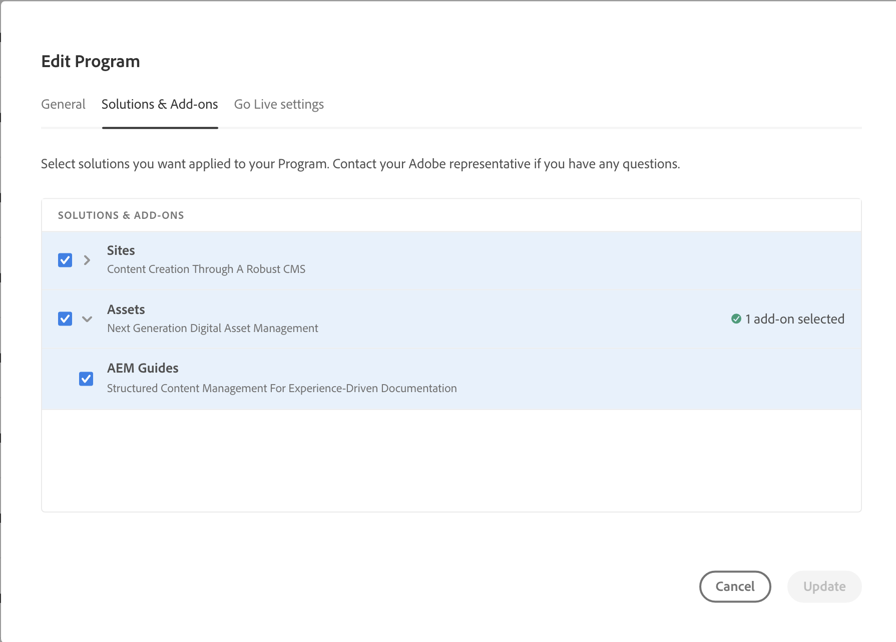

# Implementazione e configurazione del dispatcher

Questo articolo fornisce informazioni su come distribuire Experience Manager Guides as a Cloud Service e configurare Dispatcher.

## Distribuire Experience Manager Guides as a Cloud Service

Per iniziare, distribuisci Experience Manager Guides tramite Cloud Manager. Per distribuire il modulo, seguire le istruzioni indicate nella [distribuzione AEM Guides as a Cloud Service](../release-info/deploy-xml-on-aemaacs.md).

>[!NOTE]
>
> A partire dalla versione 2024.2.0, Experience Manager Guides è disponibile solo come componente aggiuntivo automatico per Experience Manager as a Cloud Service. Se utilizzi le versioni di dicembre 2023 o precedenti, puoi scaricare Adobe Experience Manager Guides dall’archivio GitHub e installarlo. Se utilizzi le distribuzioni manuali per Experience Manager Guides, rimuovi la riga `<module>dox.installer</module> from file dox/pom.xml` nella base di codice per la gestione Git del cloud prima di abilitare Experience Manager Guides per il programma.

Per distribuire il modulo Experience Manager Guides, effettua le seguenti operazioni:

1. Accedi a [!UICONTROL Cloud Manager].

1. Modificare il programma per il quale si desidera configurare [!DNL Experience Manager Guides].

1. Passa alla scheda **[!UICONTROL Soluzioni e componenti aggiuntivi]**.

1. Nella tabella **[!UICONTROL Soluzioni e componenti aggiuntivi]**, fai clic su **[!UICONTROL Assets]**.

1. Seleziona **[!UICONTROL Guide]** e seleziona **[!UICONTROL Salva]**.

Il programma per il provisioning automatico della soluzione Experience Manager Guides è stato configurato correttamente.

>[!NOTE]
>
>Per installare [!DNL Experience Manager Guides] in qualsiasi ambiente del programma integrato, è necessario eseguire la pipeline associata all&#39;ambiente. Per l&#39;installazione di [!DNL Experience Manager Guides] non è richiesta alcuna configurazione aggiuntiva nel codebase Git CM.

## Configurare Dispatcher

Dispatcher è lo strumento di caching e/o bilanciamento del carico di Adobe Experience Manager. Per ulteriori dettagli, consulta [Dispatcher nel cloud](https://experienceleague.adobe.com/docs/experience-manager-cloud-service/implementing/content-delivery/disp-overview.html?lang=en).

1. Per la migrazione della configurazione del dispatcher da AMS a Cloud Service, consulta [Migrazione della configurazione di Dispatcher da AMS ad AEM as a Cloud Service](https://experienceleague.adobe.com/docs/experience-manager-cloud-service/implementing/content-delivery/ams-aem.html?lang=en).
1. Per informazioni dettagliate su come configurare Dispatcher, vedere [Configurazione di Dispatcher](https://experienceleague.adobe.com/docs/experience-manager-dispatcher/using/configuring/dispatcher-configuration.html?lang=it).

>[!NOTE]
>
> AEM as a Cloud Service non supporta Dispatcher per l’istanza Autore.
