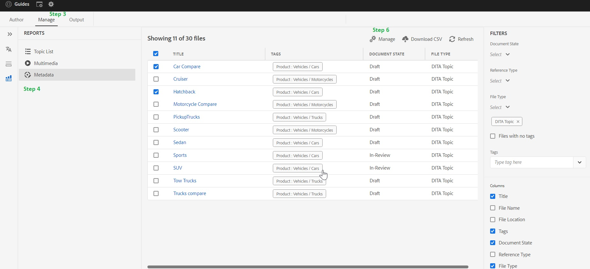

# Come aggiungere, rimuovere e gestire i tag nel contenuto DITA

I tag risultano utili per categorizzare il contenuto. Se il contenuto è correttamente taggato, può essere utile individuare gli argomenti esatti nella mappa digitale e l’utente finale può trovare il contenuto appropriato più rapidamente nell’output pubblicato

> **_NOTA:_** Il seguente articolo è per AEM Guides Build 4.2 (on-prem) /Feb 2023 (versione cloud ) o versioni successive

## Creare i tag

L’assegnazione tag è una funzione nativa di AEM e l’amministratore AEM può aiutarti nella creazione e nella configurazione iniziale di questi tag.

## Aggiungere, rimuovere e gestire i tag nel contenuto DITA

**Qualsiasi tag creato in AEM cq: tags può essere aggiunto, rimosso e gestito per i contenuti DITA**

Esistono diversi modi per aggiungere tag ai contenuti DITA, ma questo articolo si concentrerà sull’interfaccia utente dell’editor web di AEM Guides.

### Passaggi:

1. Vai alla vista archivio nell’interfaccia utente Guide
2. Fai doppio clic su mappa e apri in vista mappa
3. Vai alla scheda Gestione
4. Nella scheda Gestisci , vai all’opzione Metadati
5. Tutti i file ditamap diretti e indiretti vengono caricati qui.
6. Seleziona uno o più file e fai clic sull’icona &quot;Gestisci&quot;. Qui puoi aggiungere tag ai file selezionati.
È inoltre possibile rimuovere i tag esistenti comuni nei file selezionati.

## Risoluzione dei problemi e domande frequenti

### L’elenco in Gestisci->metadati è vuoto o incompleto

`If list is empty or  incomplete then you may need to run the indexing on your ditamap, You can refer` [Istruzioni per l&#39;aggiornamento (indicizza il contenuto)](https://experienceleague.adobe.com/docs/experience-manager-guides-learn/tutorials/install-guide/on-prem-ig/download-install-upgrade-aemg/upgrade-xml-documentation.html?lang=en#steps-to-index-the-existing-content-to-use-the-new-find-and-replace%3A)

### I metadati personalizzati non vengono visualizzati nell’elenco

`Only Tags present in cq:tags can be managed from here and custom metadata is not supported`

## Altre risorse utili

- [Assegnazione di tag in blocco tramite Map Dashboard (interfaccia utente di Assets)](https://experienceleague.adobe.com/docs/experience-manager-guides-learn/tutorials/user-guide/manaege-metadata/map-editor-bulk-tagging.html?lang=en)
- [Rapporti Ditamap nell’editor web](https://experienceleague.adobe.com/docs/experience-manager-guides-learn/tutorials/user-guide/reports-aem-guide/reports-web-editor.html?lang=en)
- [Assegnazione di tag in AEM](https://experienceleague.adobe.com/docs/experience-manager-learn/assets/configuring/tagging.html?lang=en)

**Contatta il tuo CSM per qualsiasi altra domanda**
