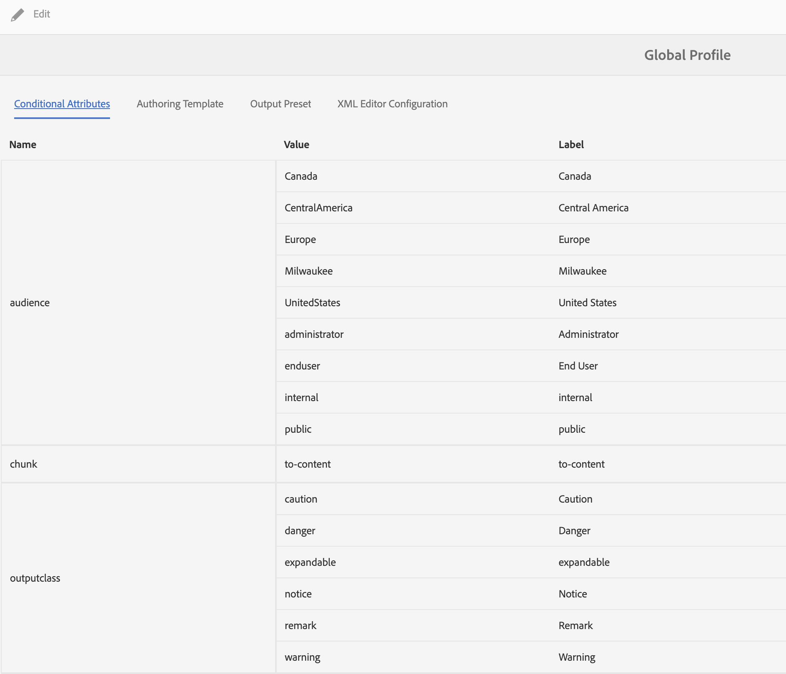
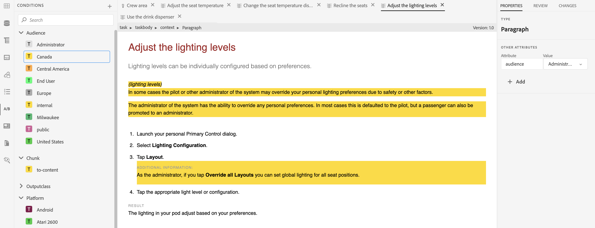

# Utilizzo di contenuti condizionali

**Caso d&#39;uso**

* Gli autori possono impostare condizioni su un contenuto in modo da controllare se viene visualizzato nell’output.

* Gli autori possono scegliere di mostrare/nascondere condizioni diverse al momento della pubblicazione.

* Ad esempio, gli autori possono aggiungere nel contenuto attributi come versione 1.0 e versione 2.0 e utilizzare le condizioni per includere la versione 1.0 per la versione 1.0 ed escludere la versione 2.0.

**Passaggio 1**

Definisci le condizioni relative alla documentazione in [!UICONTROL Profili cartella]:
Consulta la sezione **Configurare gli attributi condizionali per i profili globali o a livello di cartella** in [Pagina 69 della Guida all&#39;installazione e alla configurazione](https://helpx.adobe.com/content/dam/help/en/xml-documentation-solution/4-2/Adobe-Experience-Manager-Guides_Installation-Configuration-Guide_EN.pdf)

**Passaggio 2**

Selezionare il **[!UICONTROL Profilo cartella]** definito nel passaggio 1 in **Preferenze utente** nell&#39;editor XML:
Consulta la sezione **Preferenze utente** in [Pagina 41 della Guida utente](https://helpx.adobe.com/content/dam/help/en/xml-documentation-solution/4-2/Adobe-Experience-Manager-Guides_User-Guide_EN.pdf)

**Passaggio 3**

Utilizza le condizioni per condizionare le sezioni del contenuto:
Consulta la sezione **Condizioni** in [Pagina 90 della Guida utente](https://helpx.adobe.com/content/dam/help/en/xml-documentation-solution/4-2/Adobe-Experience-Manager-Guides_User-Guide_EN.pdf)

**Passaggio 4**

Definisci i predefiniti per le condizioni a livello di mappa per scegliere quali condizioni abilitare nell’output:
Consulta la sezione **Utilizzare i predefiniti per le condizioni** in [Pagina 249 della Guida utente](https://helpx.adobe.com/content/dam/help/en/xml-documentation-solution/4-2/Adobe-Experience-Manager-Guides_User-Guide_EN.pdf)
