# EXPERIENCE MANAGER GUIDES e EDGE DELIVERY SERVICES

Adobe Experience Manager Guides consente di pubblicare i contenuti DITA direttamente in Edge Delivery Services (EDS) tramite un profilo di pubblicazione dedicato basato su GitHub. Questa funzionalità consente alle organizzazioni di fornire esperienze di documentazione reattiva e a elevate prestazioni, mantenendo al contempo i flussi di lavoro di authoring basati su DITA in Experience Manager Guides.

Per ulteriori dettagli sull&#39;utilizzo di EDS in Adobe Experience Manager, visualizzare [Panoramica di Edge Delivery Services](https://experienceleague.adobe.com/it/docs/experience-manager-cloud-service/content/edge-delivery/overview).

Per abilitare la pubblicazione da Experience Manager Guides a EDS, è necessario completare una serie di passaggi di configurazione in GitHub e Experience Manager Guides. Le sezioni seguenti descrivono ogni passaggio in sequenza e spiegano come interagiscono nel flusso di lavoro di pubblicazione complessivo.

1. [Configurazione di GitHub per EDS](#set-up-and-configure-github-for-eds)
2. [Creare e configurare un profilo di pubblicazione per EDS in Experience Manager Guides](#create-and-configure-a-publish-profile-for-eds-in-experience-manager)
3. [Personalizzare l’output utilizzando i blocchi EDS](#customize-output-using-eds-blocks)

Per una procedura dettagliata e rapida, visualizza [Pubblicazione in AEM Guides](https://experienceleague.adobe.com/it/docs/experience-manager-guides/using/knowledge-base/expert-session/publishing-in-aem-guides-aug25).


## Configurazione di GitHub per EDS

Questa sezione descrive come impostare e configurare GitHub per l’utilizzo con EDS. Include la creazione di un archivio utilizzando la piattaforma standard Adobe, la connessione di GitHub a Adobe Experience Manager tramite AEM Code Sync, la configurazione delle applicazioni GitHub e OAuth richieste e la definizione del punto di montaggio dell’archivio utilizzato per la pubblicazione dei contenuti.

### Creare un archivio GitHub per EDS

EDS richiede un archivio GitHub con una struttura predefinita. Adobe fornisce un archivio standard ufficiale appositamente progettato per gli utenti di Experience Manager Guides.

Per creare l’archivio, effettua le seguenti operazioni:

1. Apri il repository dei modelli boilerplate di Experience Manager Guides [aem-guides-boilerplate](https://github.com/adobe/aem-guides-boilerplate).
   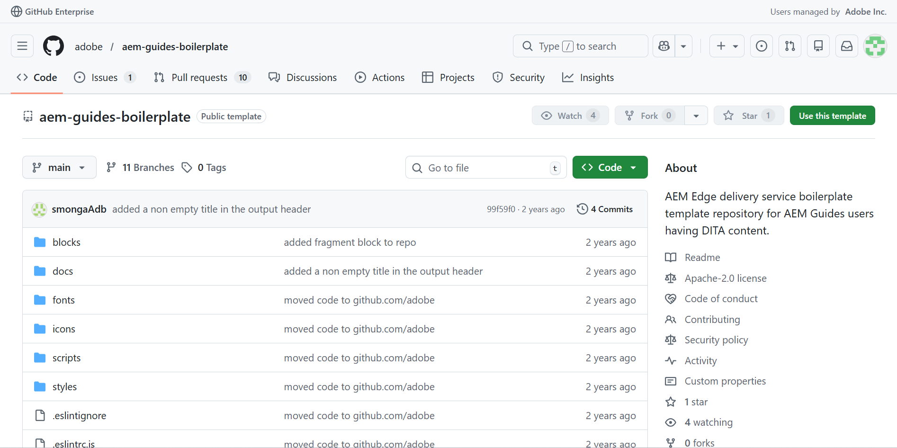

2. Crea un nuovo archivio utilizzando questo modello. Scopri come [creare un archivio da un modello](https://docs.github.com/en/repositories/creating-and-managing-repositories/creating-a-repository-from-a-template). Verificare che la visibilità dell&#39;archivio sia impostata su *Pubblico* in modo che sia accessibile da EDS.

   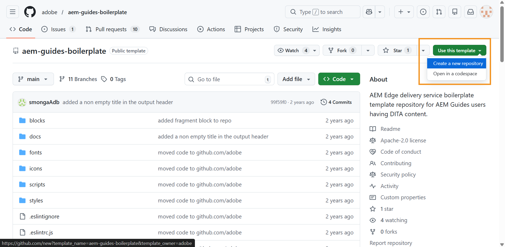

L’archivio viene ora creato e allineato con la struttura del modello standard.

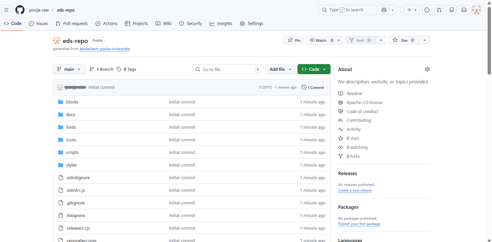

### Crea una nuova app OAuth

È necessaria un’app OAuth per autenticare gli utenti durante la creazione di un profilo di pubblicazione EDS in Experience Manager Guides. Abilita un flusso di accesso sicuro utilizzando un *ID client* e un *Segreto client*.

Per creare una nuova app OAuth, effettua le seguenti operazioni:

1. Su GitHub, passa alla barra laterale a sinistra e seleziona **Impostazioni sviluppatore**.
2. Nella barra laterale sinistra, seleziona **App OAuth**.
3. Seleziona **Nuova app OAuth**.

   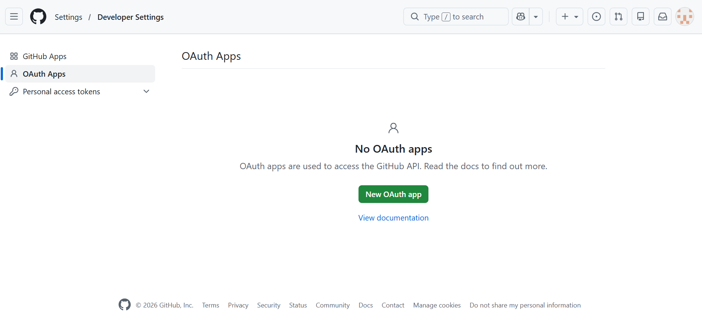{width="650"}

4. Registra l’applicazione fornendo i seguenti dettagli obbligatori:

   - **Nome applicazione**: immettere il nome dell&#39;archivio EDS
   - **URL home page**: immettere l&#39;URL dell&#39;istanza di Experience Manager Guides. Per il formato URL di esempio, fare riferimento al passaggio 4 della sezione [Creare una nuova app GitHub](#create-a-new-github-app).
   - **URL callback di autorizzazione**: uguale all&#39;URL della home page

5. Selezionare l&#39;opzione **Abilita flusso dispositivo**, quindi selezionare **Registra applicazione** per completare la registrazione.

   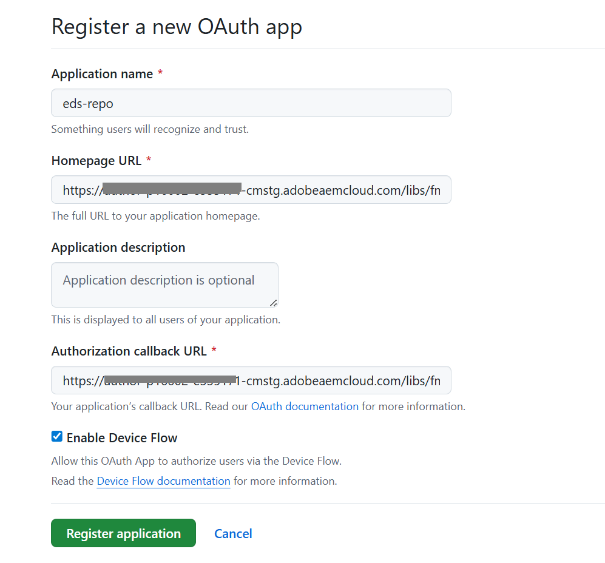{width="650"}

L&#39;app è ora pronta. Annota l&#39;*ID client*. Puoi generare fino a cinque *segreti client* ora o in seguito durante la configurazione del profilo di pubblicazione in Experience Manager Guides.

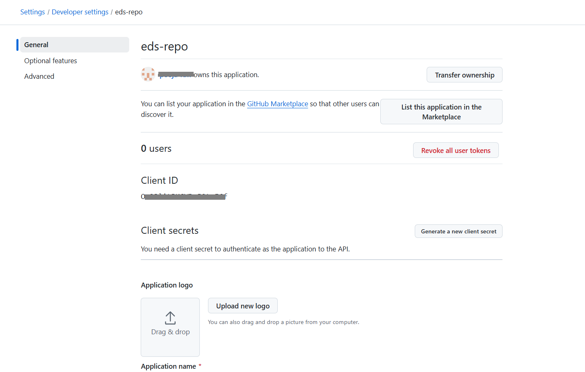


### Configurare l’URL del punto di montaggio nell’archivio EDS

EDS legge il contenuto da un URL *mountpoint* definito nel file `fstab.yaml` nella directory principale dell&#39;archivio. Questo URL punta EDS al percorso in cui Experience Manager Guides pubblica il contenuto generato.

Per configurare l&#39;URL del punto di attivazione nel file `fstab.yaml`:

1. Nell&#39;archivio GitHub, apri il file `fstab.yaml`.
2. Aggiorna il valore `url` utilizzando il seguente formato:

   ```text
   https://guides.adobe.com/eds-workers/<account type>/<git acc domain>/<git username>/<git repo>/<branch>/<root folder>
   ```

   La tabella seguente descrive ogni campo nell’URL:

   | Campo | Descrizione |
   |---|---|
   | `https://guides.adobe.com/eds-workers` | URL di lavoro utilizzato da Experience Manager Guides per pubblicare i contenuti su EDS. Non modificare questo valore. |
   | `<account type>` | Tipo di account Git. Imposta su `github`. |
   | `<git acc domain>` | Dominio dell’account Git. Imposta su `github.com`. |
   | `<git username>` | Nome utente GitHub. |
   | `<git repo>` | Nome dell’archivio GitHub creato per EDS. |
   | `<branch>` | Ramo in cui desideri pubblicare il contenuto. Il valore predefinito è `main`. Se modifichi il nome del ramo su GitHub, aggiornalo qui e nel profilo di pubblicazione EDS in Experience Manager Guides. |
   | `<root folder>` | Cartella principale dell&#39;archivio in cui viene eseguito il commit dei file pubblicati. Il valore predefinito è `docs`. Se modifichi il nome della cartella su GitHub, aggiornalo qui e nel profilo di pubblicazione EDS in Experience Manager Guides. |

   Ad esempio, se il nome utente GitHub è `my-username` e il nome dell&#39;archivio è `my-eds-repo`, il file `fstab.yaml` verrà visualizzato come segue:

   ```yaml
   mountpoints:
     /:
       url: https://guides.adobe.com/eds-workers/github/github.com/my-username/my-eds-repo/main/docs
       type: markup
   ```

   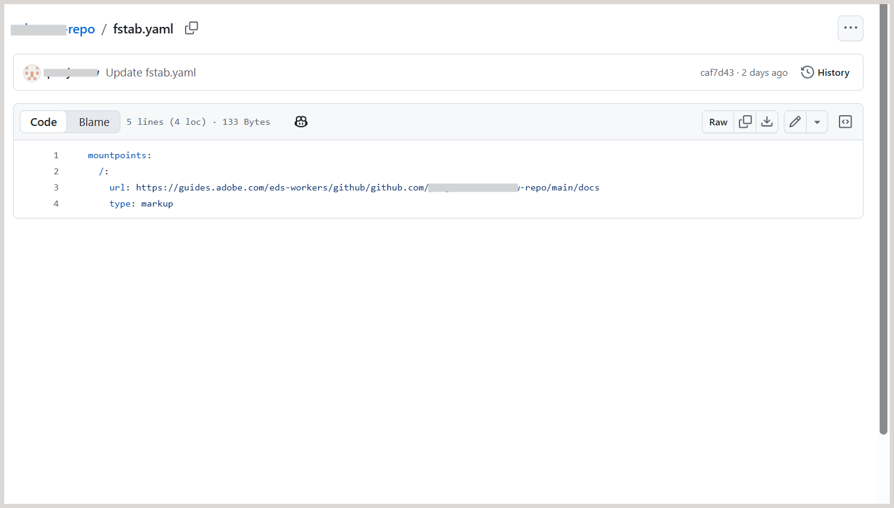{width="650"}

   >[!NOTE]
   >
   > Se si continua a utilizzare il formato URL precedente (`https://guides.adobe.com/eds-workers/<git username>/<git repo>/<branch>/<root folder>`), il tipo di account e il dominio predefiniti saranno `github` e `github.com`.

3. Ripeti i passaggi 2 e 3 dalla sezione [Connetti GitHub ad Adobe tramite AEM Code Sync](#connect-github-to-adobe-via-aem-code-sync) per autorizzare l&#39;archivio.

### Collegare GitHub ad Adobe tramite AEM Code Sync

Adobe Experience Manager utilizza un&#39;applicazione GitHub denominata **AEM Code Sync** per inviare contenuti da Experience Manager Guides a GitHub.

Per installare e configurare l&#39;applicazione *AEM Code Sync*, effettuare le seguenti operazioni:

1. Passare alla pagina [Sincronizzazione codice AEM](https://github.com/apps/aem-code-sync) e selezionare **Installa**.

   **AEM Code Sync** monitora le modifiche all&#39;archivio e assicura che gli aggiornamenti vengano inviati correttamente a GitHub.

   >[!NOTE]
   >
   >Durante l’installazione dell’applicazione, assicurati di utilizzare lo stesso account GitHub a cui appartiene l’archivio.

   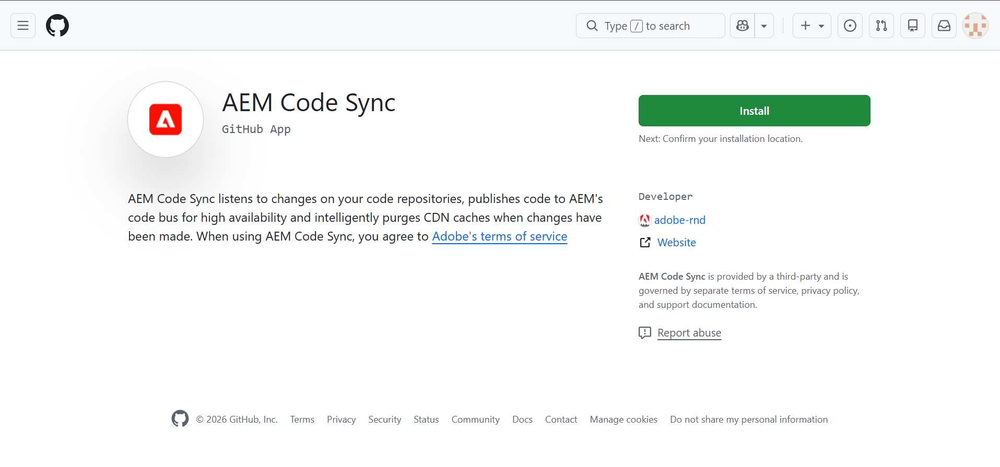

2. Nella pagina successiva, concedi l’accesso all’archivio creato. Seleziona **Solo repository**, quindi seleziona il tuo archivio dal menu a discesa.

   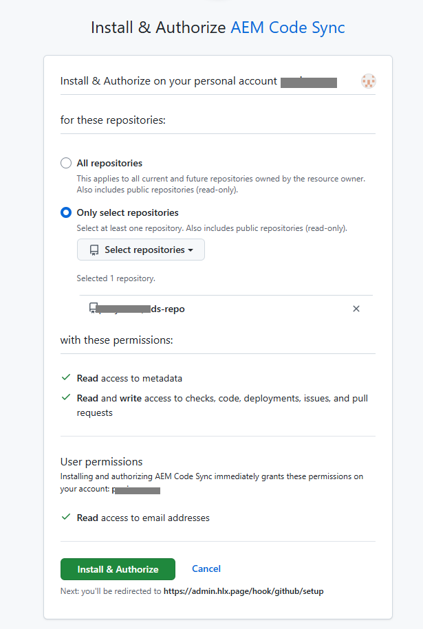{width="350"}

3. Selezionare **Installa e autorizza**.

   Viene visualizzata la pagina di configurazione di GitHub.

   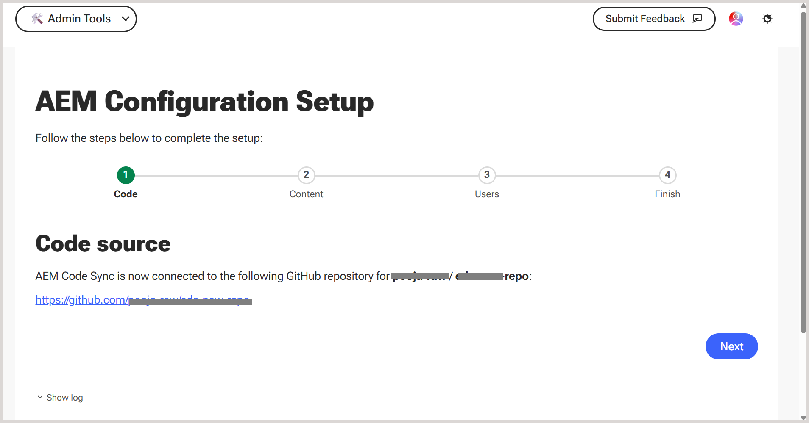

4. Rivedi i dettagli del codice sorgente e seleziona **Avanti**.

5. Nella pagina **Origine contenuto** configurare le impostazioni seguenti:

   - **Tipo di origine del contenuto:** Seleziona **Altro (inserisci il tuo markup)**.
   - **URL origine contenuto:** Verificare l&#39;URL configurato come URL punto di montaggio nel file `fstab.yaml`. Se non hai aggiornato l’URL nel file, puoi aggiornarlo qui.
   - **Estensione file:** Modificare il suffisso predefinito `.html` in `.htm`.

   Assicurarsi che sia selezionato **Usa un&#39;origine di contenuto diversa**.

6. Nella pagina **Utenti**, aggiungi gli utenti se necessario, quindi seleziona **Successivo**.

7. Rivedi il riepilogo della configurazione e seleziona **Salva**.

   Dopo la registrazione, viene visualizzata una pagina di conferma. Puoi copiare e salvare gli URL **Anteprima** e **Live** per il tuo sito Web da questa pagina.

   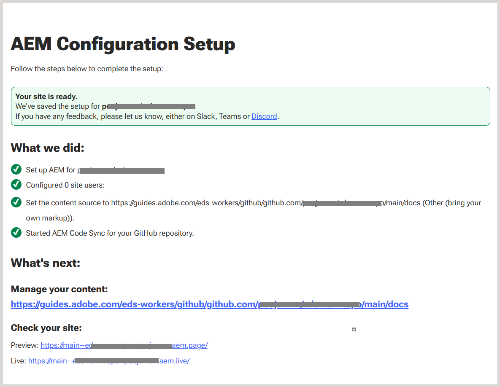

## Configurazione di GitLab per EDS

Per istruzioni sulla configurazione di GitLab come archivio di pubblicazione per Edge Delivery Services, visualizzare [Configurare GitLab per EDS](./configure-eds-gitlab.md).

## Creare e configurare un profilo di pubblicazione per EDS in Experience Manager

Le sezioni seguenti descrivono ogni passaggio in sequenza e spiegano come impostare il profilo di pubblicazione EDS, configurare un predefinito di output e generare l’output utilizzando EDS in Experience Manager Guides.

### Creare il profilo di pubblicazione EDS per GitHub o GitLab

1. Vai a **[Impostazioni Workspace](/help/product-guide/cs-install-guide/workspace-settings.md)** **>** **Pubblica profili**.
2. Seleziona l&#39;icona **+** per creare un nuovo profilo di pubblicazione e fornisci i seguenti dettagli:

   - **Tipo di server\*:** Seleziona **Git (Edge Delivery Service)** dal menu a discesa.
   - **Nome\*:** Immettere un nome per il profilo di pubblicazione.
   - **Tipo di account Git\*:** Seleziona **GitHub** o **GitLab** dal menu a discesa, a seconda del provider dell&#39;archivio Git.
   - **URL istanza\*:** Inserisci l&#39;URL dell&#39;istanza GitHub o GitLab, ad esempio `https://github.com` o `https://gitlab.com`.
   - **Nome archivio\*:** Inserisci il nome dell&#39;archivio GitHub o GitLab.
   - **Nome utente\*:** Inserisci il nome utente GitHub o GitLab.
   - **Nome ramo:** Impostato su `main` (impostazione predefinita).
   - **Cartella principale\*:** Impostata su `docs` (impostazione predefinita).
   - **Proprietario sito (*Solo GitLab*):** Immettere il proprietario del sito Edge Delivery Services.
   - **Archivio sito (*Solo GitLab*):** Immettere il nome dell&#39;archivio associato al sito Edge Delivery Services.
   - **Chiave API HLX:** Immettere la chiave API HLX per la configurazione EDS. Questa chiave è necessaria per supportare la funzione Non pubblicato introdotta nella versione 2026.11.0 di Experience Manager Guides as a Cloud Service. Inoltre, la chiave è necessaria per pubblicare il contenuto in EDS se la dimensione del contenuto è superiore a 100 file.
   - **Credenziali di autenticazione:** Specificare le credenziali in base al tipo di account Git selezionato:
     - **GitHub:** Immetti l&#39;**ID client\*** e il **Segreto client\*** ottenuti dall&#39;app OAuth GitHub. Per ulteriori informazioni, consulta [Creare una nuova app OAuth](#create-a-new-oauth-app).
     - **GitLab:** Immetti il **token di accesso\*** generato per l&#39;account GitLab.
3. (*Solo GitHub*) Seleziona **Accesso** per eseguire l&#39;autenticazione. Per GitLab, non è necessario alcun accesso perché il token di accesso viene utilizzato per l’autenticazione.

   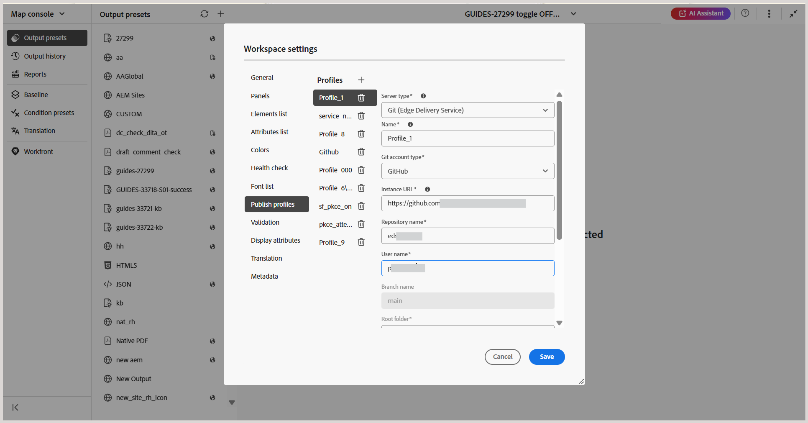{width="650"}

4. Seleziona **Salva**. Per GitHub, l&#39;opzione **Salva** è disponibile dopo la corretta autenticazione.

Il profilo di pubblicazione EDS è ora configurato.

### Creare un predefinito di output per EDS e generare un output

1. Apri la mappa nella console Mappa.
2. Nella scheda **Predefiniti di output**, selezionare **+** per creare un nuovo predefinito di output.
3. Nella finestra di dialogo **Nuovo predefinito di output**, fornisci i seguenti dettagli:
   - **Tipo**: Seleziona **Servizio Edge Delivery**
   - **Nome**: specifica un nome per questo predefinito
4. Seleziona **Aggiungi**.

   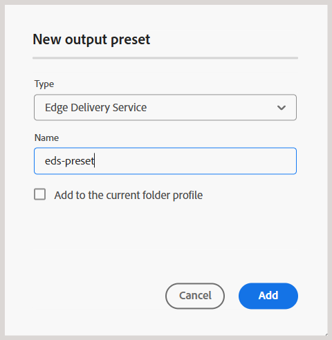{width="650"}
5. Apri il predefinito di output EDS appena creato e configura i campi seguenti:

   - **Filtro condizionale:** Seleziona **Nessuno** per generare l&#39;output senza filtri o **Utilizza DITAVAL** per applicare il filtro condizionale.
   - **Sottocartella di pubblicazione:** Immettere il nome della sottocartella in cui viene pubblicato l&#39;output. La sottocartella viene creata nel repository sotto la cartella principale e il suo nome viene visualizzato nei collegamenti EDS al contenuto pubblicato. Ad esempio, se la cartella principale è `docs` e la sottocartella di pubblicazione è `product-guide`, il contenuto verrà pubblicato in `docs/contents/product-guide`.
   - **Profilo di pubblicazione:** Seleziona il profilo di pubblicazione GitHub o GitLab configurato nella sezione precedente.

     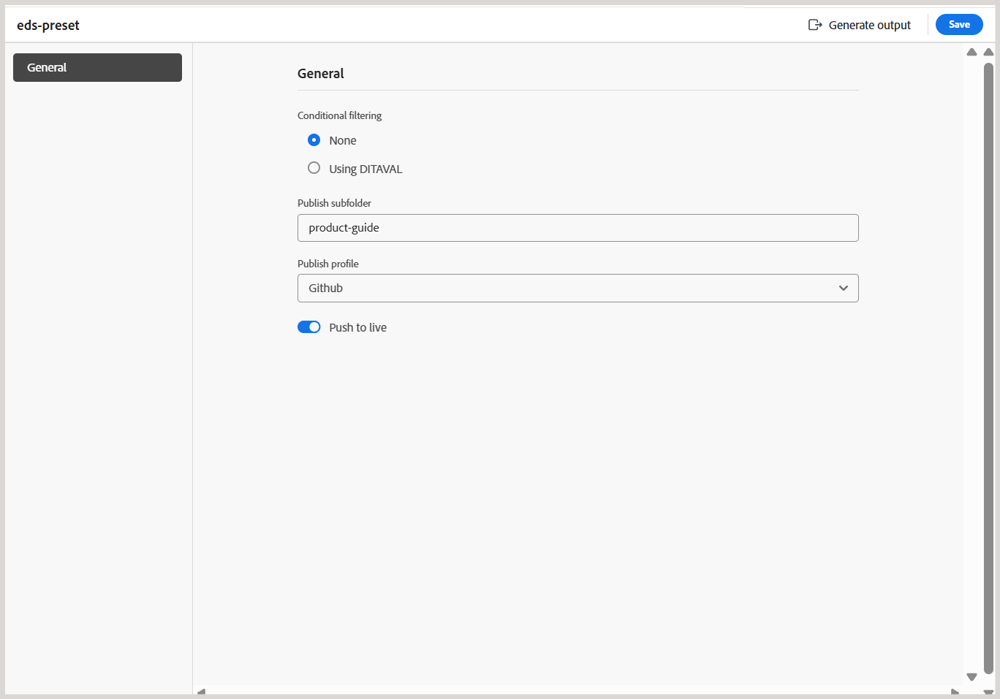{width="650"}

6. Selezionare **Salva**, quindi **Genera output**.

>[!NOTE]
>
>L&#39;output generato viene archiviato nella cartella `<root folder>/contents/<publish subfolder>` dell&#39;archivio EDS.

L&#39;output EDS viene ora generato. Il contenuto viene presentato in un layout pulito e reattivo. Include elementi regolari come il titolo della pagina, le breadcrumb, il contenuto del corpo e tutti i blocchi utilizzati nell’argomento. Il sommario a sinistra (generato dalla mappa) consente di navigare tra gli argomenti, mentre un mini-sommario a destra evidenzia le sezioni all’interno della pagina corrente. L’intero output è completamente reattivo, garantendo un’esperienza di lettura ottimizzata e coerente tra i dispositivi.

>[!NOTE]
>
> È possibile pubblicare più mappe DITA sullo stesso sito Web. Le mappe pubblicate vengono visualizzate nel pannello di navigazione a sinistra, consentendo agli utenti di accedere al contenuto di ogni mappa. La pubblicazione di una nuova mappa non sovrascrive le mappe pubblicate in precedenza.

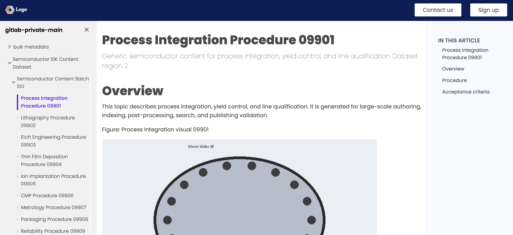

## Personalizzare l’output utilizzando i blocchi EDS

EDS utilizza `blocks` per controllare lo stile e la visualizzazione delle diverse parti del contenuto. Puoi modificare i blocchi esistenti o crearne di personalizzati.

Gli esempi descritti di seguito descrivono come personalizzare un blocco esistente e crearne uno nuovo per applicare uno stile all&#39;output finale EDS in Experience Manager Guides.

### Personalizzare un blocco di breadcrumb per aggiornarne il colore del testo

Le breadcrumb vengono utilizzate in più pagine per aiutare gli utenti a capire dove si trovano nella documentazione. Poiché questo blocco viene visualizzato in modo coerente in tutto il sito web, l’aggiornamento dello stile consente un aggiornamento unificato del design.

Per personalizzare un blocco di breadcrumb per aggiornarne il colore del testo, effettua le seguenti operazioni:

1. Vai all&#39;archivio GitHub e apri la cartella `blocks`.
2. Seleziona il blocco **breadcrumb**.

   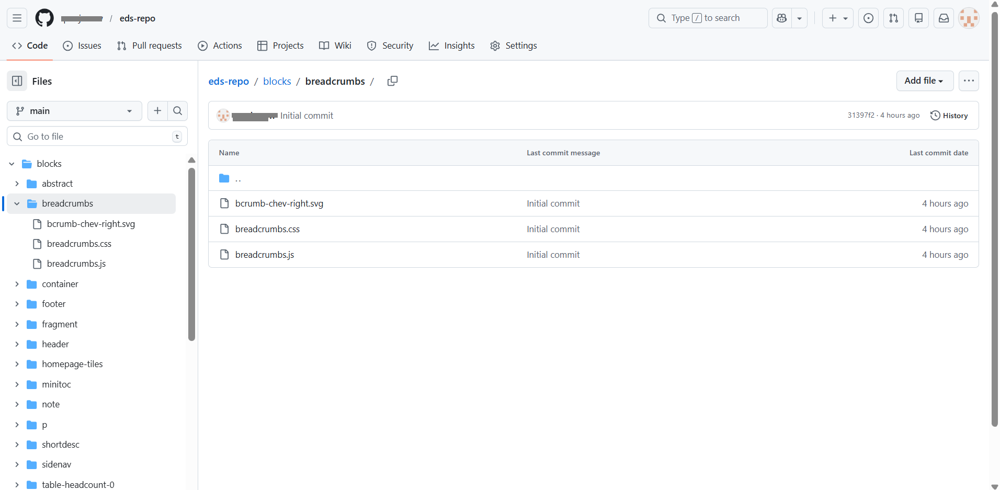{width="650"}
3. Aprire il file `css` e aggiornare il colore del testo.
4. Apporta le modifiche a GitHub.
5. Aggiorna il sito web live per visualizzare gli aggiornamenti.

### Aggiornare gli script EDS per creare un elemento personalizzato nell’output pubblicato

In alcuni casi, potrebbe essere utile applicare uno stile solo a una parte specifica del contenuto. Per ottenere questo risultato, esegui i seguenti passaggi utilizzando un blocco personalizzato.

1. Aprire il file dell&#39;argomento e selezionare il testo all&#39;interno di un elemento tag.

   Nella schermata seguente, il contenuto all&#39;interno del tag `example` è selezionato.
   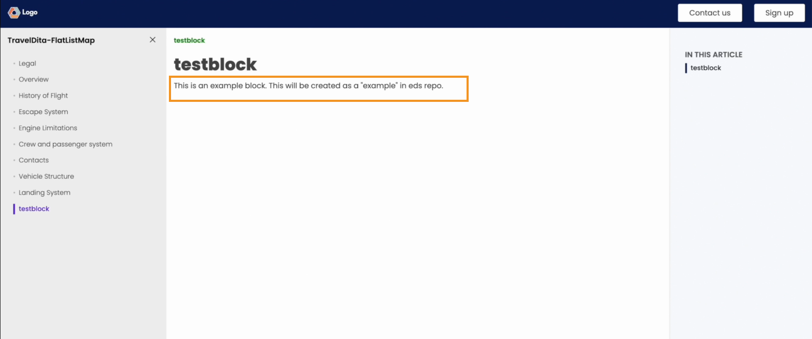{width="650"}
2. Per configurare il testo all&#39;interno del tag `example`:
   - Passa a **Proprietà contenuto**.
   - Aggiungi l&#39;attributo `outputclass`.
   - Imposta il relativo valore su `example eds-force-block`.
   - Seleziona **Aggiungi**.
     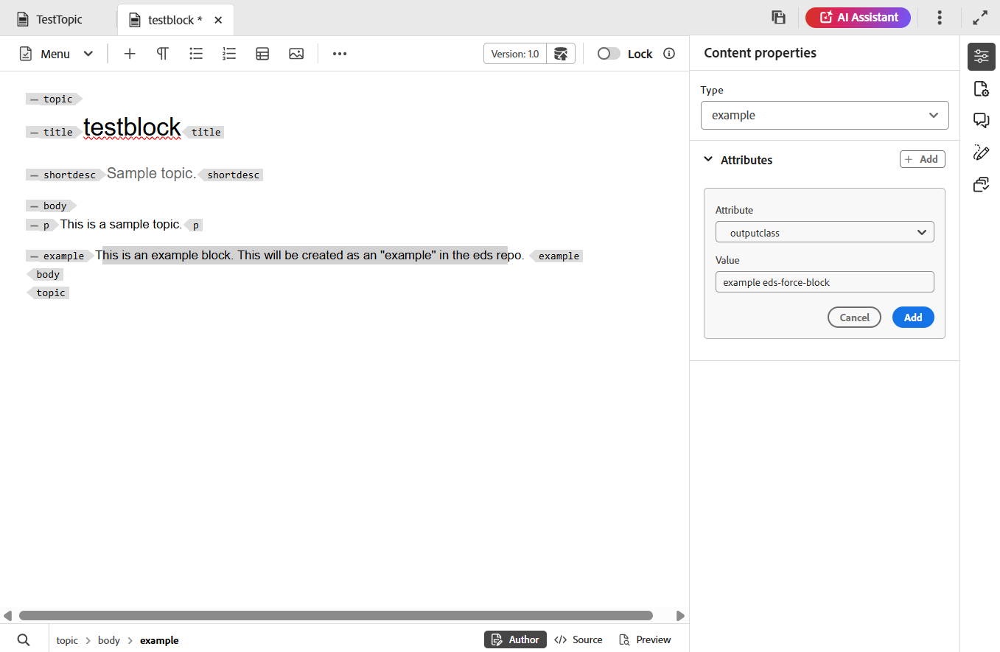{width="650"}
3. Salvate e rigenerate l&#39;output.
4. Creare una nuova cartella con lo stesso nome di `outputclass` nella directory `blocks`. Scopri come [aggiungere file a un repository](https://docs.github.com/en/repositories/working-with-files/managing-files/adding-a-file-to-a-repository#adding-a-file-to-a-repository-using-the-command-line).

   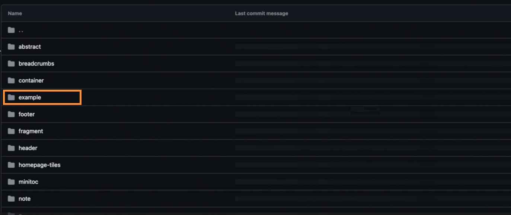{width="650"}

5. Aggiungere i file richiesti `css` e facoltativi `js`.

   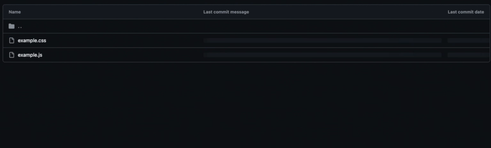{width="650"}

6. Eseguire il commit delle modifiche e rigenerare l&#39;output.

Il contenuto selezionato ora visualizza lo stile personalizzato definito nel blocco.

{width="650"}
