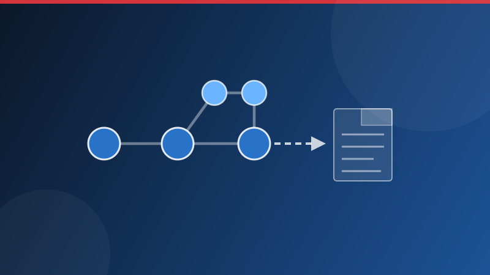
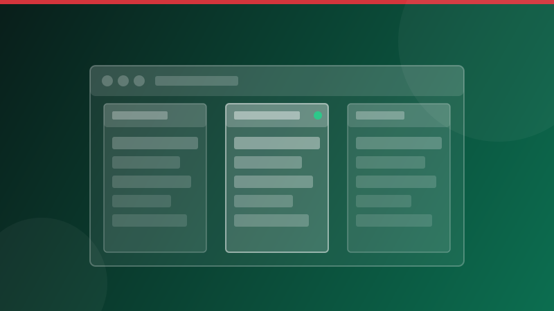

# Documentazione di Experience Manager Guides

Experience Manager Guides è un CCMS di livello enterprise con supporto DITA nativo per l&#39;authoring strutturato, la pubblicazione multicanale e la gestione del ciclo di vita dei contenuti.

**Distribuzione:** [!BADGE Cloud Service]{type=Positive} [!BADGE On-Premise]{type=Informative}

## Inizia in base al ruolo

::::landing-cards-container
:::card

Amministratori

Configura profili di cartelle, autorizzazioni, impostazioni del flusso di lavoro e modelli di output.

[Guida all’amministrazione](./install-conf-guide/introduction.md)
:::

:::card

Autori

Creazione e gestione di argomenti DITA, mappe, riutilizzo dei contenuti e flussi di lavoro di revisione.

[Panoramica sull’authoring](./user-guide/authoring-content.md)
:::

:::card

Editori

Imposta i predefiniti di output, gestisci le linee di base e genera l&#39;output tra i canali.

[Gestione delle mappe e pubblicazione](./user-guide/map-console-overview.md)
:::

::::

<!--
:::card

Architects

Design DITA specializations, schemas, and content architecture for your implementation.

[DITA specialization](./install-conf-guide/dita-ot-specialization.md)
:::

::::
-->

## Esplora per area delle caratteristiche

<!-- Author note: Six cards wrap to two rows of three in production. The landing-cards-container component is in beta — verify rendering in production before publishing. -->

::::landing-cards-container

:::card

Authoring

Creare e modificare contenuti strutturati utilizzando le funzionalità di creazione Editor e DITA.

[Creare i contenuti](./user-guide/web-editor.md)
:::

:::card

Assistente IA

Accelera la creazione di contenuti, trova risposte e applica tag intelligenti con assistenza basata sull’intelligenza artificiale.

[Assistente IA](./user-guide/ai-assistant.md)
:::

:::card

Rivedere

Crea e gestisci attività di revisione, collabora ai feedback e invia commenti di revisione.

[Introduzione alla revisione](./user-guide/review.md)
:::

:::card

Pubblicazione

Configura e genera l’output in AEM Sites, PDF, HTML5, EPUB, JSON e altri formati.

[Pubblicare i contenuti](./user-guide/generate-output.md)
:::

:::card

Traduzione

Traduci il contenuto utilizzando flussi di lavoro di traduzione umana o automatica e tieni traccia dello stato della traduzione.

[Tradurre il contenuto](./user-guide/translation.md)
:::

:::card

Rapporti

Valutare lo stato dei contenuti, gestire i metadati, identificare i collegamenti interrotti e analizzare il riutilizzo dei contenuti.

[Generare rapporti](./user-guide/reports-intro.md)
:::

::::

## Risorse e aggiornamenti

>[!BEGINSHADEBOX]

<table>
<tr style="border: 0;">
<td>

**Novità di AEM Guides**

Esplora le nuove funzioni migliorate introdotte nell’ultima versione di Experience Manager Guides, 2026.11.0.

- Diramazione e unione a livello di mappa
- Creazione e importazione di contenuti in AI Assistant
- Nuovo pannello dell’assistente della Guida

[Esplora tutto](../../help/product-guide/release-info/whats-new-2026-11-0.md)

</td>
<td>

**Note sulla versione**

Scopri le ultime note sulla versione e gli aggiornamenti dei prodotti per le distribuzioni Cloud e On-Premise.

- Versioni cloud | [Visualizza note sulla versione](./release-info/latest-release-info-cs.md)
- Versioni on-premise | [Visualizza note sulla versione](./release-info/latest-release-info.md)

[Visualizza roadmap delle versioni](./release-info/aem-guides-releases-roadmap.md)

</td>
<td>

**Informazioni e supporto**

Accedi a risorse utili, documentazione e supporto per ottenere il massimo dalla piattaforma.

* [Archivio GitHub](https://github.com/AdobeDocs/experience-manager-guides.en){target="_blank"}
* [Supporto](https://experienceleague.adobe.com/support/v2/en/){target="_blank"}
* [Tutorial video](https://experienceleague.adobe.com/en/docs/experience-manager-guides-learn/videos/getting-started/overview){target="_blank"}
* [Community di AEM Guides](https://experienceleaguecommunities.adobe.com/adobe-experience-manager-guides-11){target="_blank"}

</td>
</tr>
</table>

>[!ENDSHADEBOX]

