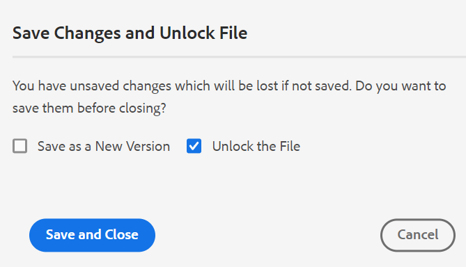
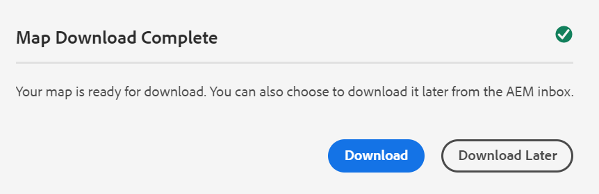

# Versione di febbraio di [!DNL Adobe Experience Manager Guides] as a Cloud Service

## Effettua l’aggiornamento alla versione di febbraio

Aggiorna la configurazione corrente di [!DNL Adobe Experience Manager Guides] as a Cloud Service (in seguito denominata [!DNL AEM Guides] as a Cloud Service) eseguendo i seguenti passaggi:
1. Consulta il codice Git dei servizi cloud e passa al ramo configurato nella pipeline dei servizi cloud corrispondente all’ambiente da aggiornare.
1. Aggiorna la proprietà `<dox.version>` nel file `/dox/dox.installer/pom.xml` del codice Git dei servizi cloud a 2022.2.114.
1. Eseguire il commit delle modifiche ed eseguire la pipeline dei servizi cloud per eseguire l&#39;aggiornamento alla versione di febbraio di [!DNL AEM Guides] as a Cloud Service.

## Matrice di compatibilità

In questa sezione viene elencata la matrice di compatibilità per le applicazioni software supportate da [!DNL AEM Guides] as a Cloud Service versione di febbraio 2022.

### FRAMEMAKER e FRAMEMAKER PUBLISHING SERVER

| FMPS | FrameMaker |
| --- | --- |
| Non compatibile | Aggiornamento 2020 4 e versioni successive |
| | |

### Connettore ossigeno

| Versione cloud [!DNL AEM Guides] | Finestre del connettore dell&#39;ossigeno | Connettore di ossigeno Mac |
| --- | --- | --- |
| 2022.2.0 | 2.4.0 | 2.4.0 |
|  |  |  |

## Nuove funzioni e miglioramenti

### Pubblicazione nativa su PDF

Il supporto per la creazione di un PDF nativo è stato aggiunto anche nella versione di febbraio di [!DNL AEM Guides] as a Cloud Service. È stato introdotto un nuovo motore di pubblicazione con le seguenti caratteristiche:
* Creare un modello CSS
* Creare diversi modelli di pagina
* Progettare modelli PDF comprendenti CSS e modelli di pagina
* Pubblicare contenuti di mappe e argomenti in formato PDF

### Supporto per il percorso del sito della knowledge base nella pubblicazione basata su articoli

[!DNL AEM Guides] as a Cloud Service fornisce la funzionalità di pubblicazione basata su articoli per generare in modo incrementale un output di uno o più argomenti o pubblicare il contenuto in una piattaforma knowledgebase. Con la versione di febbraio, è disponibile un&#39;opzione aggiuntiva per scegliere il percorso del sito della Knowledge Base in cui pubblicare l&#39;argomento o la mappa. Dopo aver selezionato il percorso, l’output viene generato nel percorso specificato.

### Miglioramenti dell’editor web

Nell’editor web sono stati aggiunti molti miglioramenti e nuove funzioni:

* **Finestra di dialogo migliorata alla chiusura del file**

[!DNL AEM Guides] as a Cloud Service richiede di salvare le modifiche e sbloccare i file bloccati quando si tenta di chiudere un file aperto nell&#39;editor Web. Le richieste vengono visualizzate in base alle impostazioni **Richiedi archiviazione alla chiusura** e **Richiedi nuova versione alla chiusura** configurate dall&#39;amministratore.

In base alla configurazione, è possibile salvare le modifiche e creare una nuova versione del documento. In alternativa, è possibile archiviare il file e salvare le modifiche apportate alla versione corrente.

Per ulteriori dettagli, vedere *Scenari di chiusura e salvataggio dei file* nella Guida utente.

* Al pallet dei caratteri è stato aggiunto uno spazio unificatore.  Uno spazio **unificatore** impedisce un&#39;interruzione di riga automatica in un punto particolare di un documento di HTML. L’editor web supporta uno spazio unificatore sia per l’output di AEM Site che per quello di HTML5.

* Quando carichi un’immagine dall’editor web, viene visualizzata una finestra di dialogo di conferma se esiste già un’immagine con lo stesso nome. È possibile mantenere entrambi i file, ovvero esistente e nuovo, oppure sovrascrivere il file esistente e salvare solo il nuovo file.

* Se un utente ha bloccato un file per le modifiche, un amministratore può rilasciare il blocco e archiviare il file. Questa funzionalità risulta utile quando alcuni file devono essere modificati ma sono stati bloccati da utenti non disponibili per l&#39;archiviazione

### Dashboard mappa

Quando si sceglie di scaricare la mappa DITA, la richiesta viene inserita in coda e si riceve una notifica quando la mappa è pronta per il download. Puoi scegliere di scaricare il file mappa immediatamente o in un secondo momento dal collegamento fornito nella casella in entrata delle notifiche di AEM.

### Rivedere

È possibile indicare i dettagli nel campo descrizione dell&#39;attività di revisione e visualizzarli nell&#39;e-mail inviata al revisore.

## Problemi risolti

Di seguito sono elencati i bug risolti in varie aree:

### Pubblicazione basata su articolo

* La pubblicazione basata su articoli non pubblica gli articoli in base alla linea di base selezionata. (8771)
* I file DITAVAL non vengono rispettati nella pubblicazione basata su articoli. (8770)
* Impossibile eseguire la pubblicazione basata su articolo per il profilo Salesforce quando il tipo di record è Domande frequenti e il contenuto del campo articolo è Domanda. (8448)
* Impossibile eseguire la pubblicazione basata su articoli per il profilo Salesforce quando il tipo di record è Manuale. (8447)

### Editor web

* Il trascinamento e il rilascio di una condizione non funzionano sugli argomenti DITA. (8761)
* Attributi mancanti quando si aggiunge un capitolo a una mappa segnalibro mediante trascinamento dalla vista Preferiti. (8746)
* La modifica delle proprietà di un&#39;immagine (altezza, larghezza) genera un errore di applicazione. (8722)
* I collegamenti interrotti non vengono visualizzati nel pannello Struttura nella vista origine. (8590)
* Editor XML rimuove il tag di nuova riga nel blocco di codice. (8522)
* Glossusage viene visualizzato come Nota quando si crea un Glossentry. (8384)
* impossibile inserire xref anche in posizioni valide. (8354)
* L&#39;elenco degli elementi (ALT+INVIO) appare in grigio nel tema scuro/più scuro. (7913)
* L&#39;elenco dei modelli di mappa nell&#39;opzione **Crea** (menu con puntini di sospensione) del pannello Archivio non corrisponde a quello del **Profilo cartella** in Preferenze utente. (5918)
* Gli ID degli elementi non vengono generati automaticamente per gli elementi aggiunti dalla funzione Riutilizza contenuto della barra degli strumenti principale. (5826)

### Interfaccia utente di Assets

* La modifica delle immagini non funziona come previsto nel server cloud. (8768)
* Nel pannello Cronologia versioni, la sezione della versione corrente mostra una marca temporale errata e informazioni modificate da. (8765)
* Il caricamento di file DITAVAL sul server cloud non riesce quando si utilizza lo strumento desktop AEM. (8707)
* Impossibile aggiungere il secondo utente amministratore come primo utente amministratore a una cartella. (8430)
* Le proprietà non univoche di una risorsa non vengono copiate quando la risorsa viene copiata e incollata. (8241)

### Modifiche all’usabilità

* Nel pannello Revisione dell&#39;Editor Web, se un nome utente è lungo, le icone da accettare/rifiutare non vengono visualizzate chiaramente. (8793)
* Nel pannello **Trova e sostituisci** viene visualizzata un&#39;icona indesiderata al passaggio del mouse nella sezione dei risultati. (8775)
* L’icona personalizzata non viene selezionata dalla proprietà, ma viene visualizzata l’icona predefinita per i rapporti generati utilizzando il pulsante Genera rapporto. (8573)
