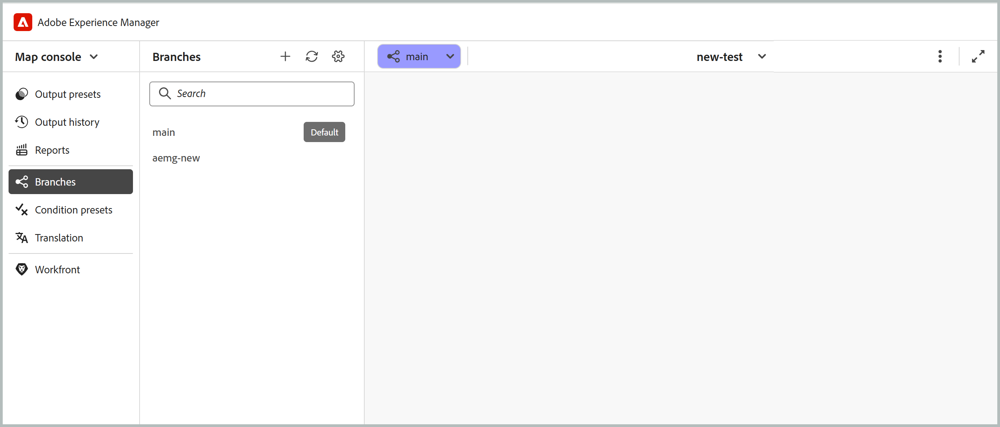
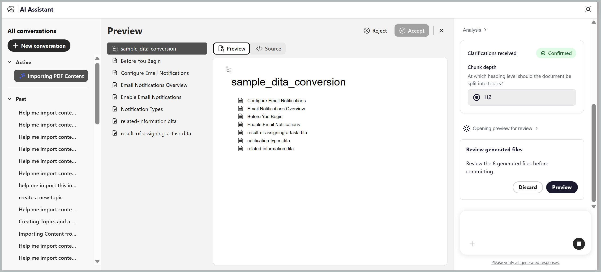
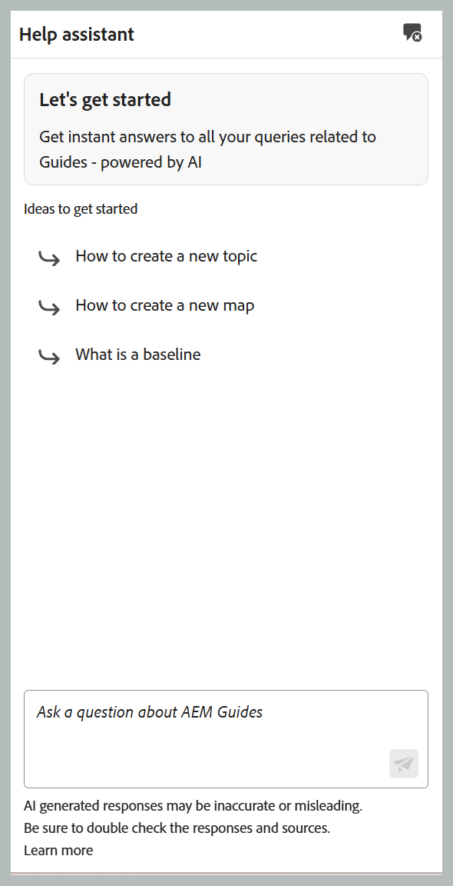
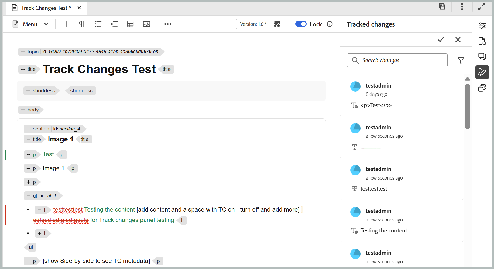
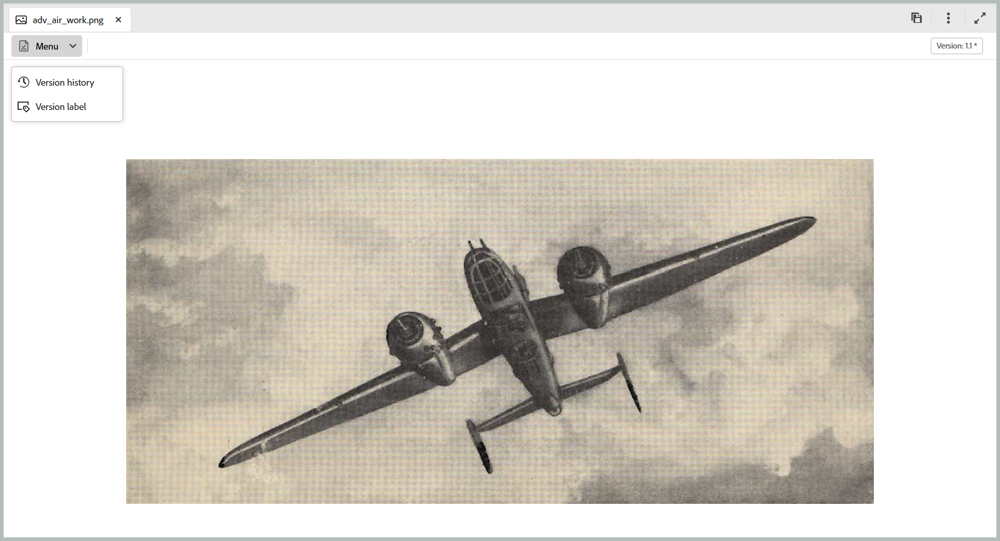
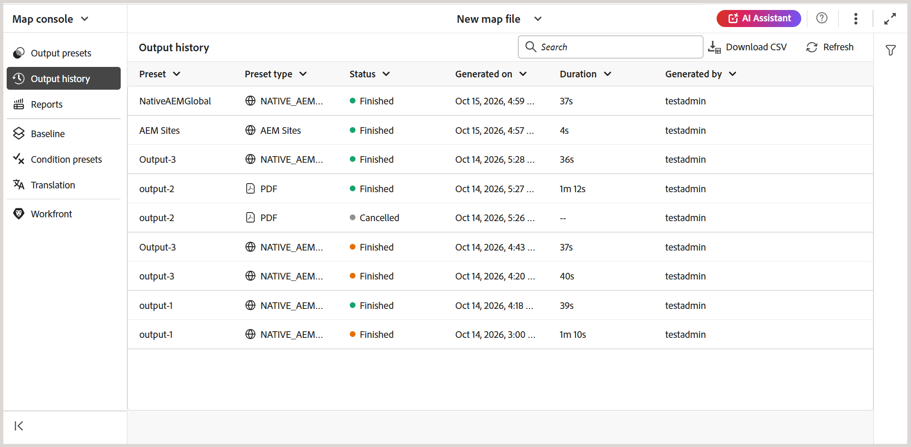

# Novità della versione 2026.11.0 (novembre 2026)

Questo articolo descrive le funzioni nuove e migliorate introdotte con la versione 2026.11.0 di Adobe Experience Manager Guides as a Cloud Service.

Per l&#39;elenco dei problemi risolti in questa versione, visualizza [Problemi risolti nella versione 2026.11.0](fixed-issues-2026-11-0.md).

Scopri le [istruzioni di aggiornamento per la versione 2026.11.0](../release-info/upgrade-instructions-2026-11-0.md).

## Introduzione alla diramazione e all&#39;unione a livello di mappa

Adobe Experience Manager Guides introduce la funzionalità di diramazione e unione a livello di mappa, che consente agli autori di lavorare su più versioni della documentazione, aggiornamenti delle funzioni e correzioni critiche in parallelo senza influire sul contenuto principale. Gli autori possono creare rami isolati di una mappa DITA e delle relative dipendenze, garantendo che le modifiche, i blocchi e le anteprime rimangano specifici per ogni ramo.

Questa funzionalità consente ai team di documentazione di gestire flussi di lavoro paralleli, collaborare in modo efficiente e mantenere la stabilità della versione principale della documentazione. Operazioni disponibili:

- **Creare rami** dalla versione principale di una mappa DITA per lavorare su funzioni, miglioramenti o correzioni critiche in modo indipendente.
- **Passa da un ramo all&#39;altro** nell&#39;editor per gestire più versioni della documentazione.
- **Gestisci le versioni dei contenuti** per organizzare le modifiche tramite diramazione e unione.
- **Risolvere i conflitti di unione** utilizzando un flusso di lavoro di confronto guidato con unione a tre vie.
- **Unisci le modifiche** nella versione principale.
- **Pubblica direttamente da un ramo** utilizzando la pubblicazione standard senza modificare la versione principale.

Ulteriori informazioni su [Diramazione e unione](../user-guide/branching-overview.md).

{width="650"}

## Creazione di contenuti basati sull’intelligenza artificiale e importazione di competenze in AI Assistant

>[!NOTE]
>
>Per utilizzare l’Assistente AI in modalità Agentic, la tua organizzazione deve aver effettuato l’onboarding in Adobe CX Enterprise Coworker e disporre dei crediti richiesti.

È ora possibile utilizzare **Assistente AI** per creare e importare contenuti DITA utilizzando prompt in linguaggio naturale. Basate su **Adobe CX Enterprise Coworker**, le nuove competenze **Create** e **Import** semplificano la creazione di contenuti strutturati e aiutano gli autori a lavorare con i contenuti DITA senza richiedere competenze DITA approfondite.

- **Crea:** genera argomenti e mappe DITA da prompt in linguaggio naturale, documenti di riferimento o contenuto esistente utilizzando i modelli del repository. Puoi rivedere il contenuto generato prima di salvarlo e perfezionare iterativamente il contenuto nuovo o esistente per soddisfare le tue esigenze.
- **Importa:** Converti i file PDF, DOCX o Markdown esistenti in mappe e argomenti DITA strutturati. Puoi visualizzare in anteprima e rivedere il contenuto convertito prima di salvarlo nell’archivio.
- **Applicazione di tag avanzati:** Ottieni consigli sui tag pertinenti per il contenuto in base alla tassonomia della tua organizzazione. L’esperienza migliorata consente agli amministratori dei profili di cartelle di configurare gli spazi dei nomi della tassonomia nelle impostazioni di Workspace, garantendo coerenza e regole nei consigli sui tag.

Il pannello **Assistente AI** introduce anche una modalità a schermo intero e una sezione **Conversazioni attive** per un&#39;esperienza di conversazione migliorata.

Per ulteriori dettagli, visualizzare [Utilizzare l&#39;Assistente di intelligenza artificiale in modalità agente](../user-guide/ai-assistant.md#agentic-mode).

{width="650"}

## Nuovo pannello dell’Assistente in Experience Manager Guides

La funzionalità **Smart Help** basata sull&#39;intelligenza artificiale è disponibile tramite il pannello dedicato **Assistente Guida**, accessibile dalle interfacce Homepage, Editor e Map Console. Il pannello offre un’esperienza di ricerca conversazionale, consentendoti di porre domande in linguaggio naturale e di trovare rapidamente informazioni rilevanti dalla documentazione di Experience Manager Guides. In questo modo puoi accedere alle indicazioni contestuali e risolvere le query senza uscire dall’Editor, semplificando il flusso di lavoro di authoring.

Gli amministratori possono gestire la disponibilità del pannello Aiuto tramite le impostazioni di Workspace. La sezione **Assistente risorse AI** include un interruttore per attivare o disattivare il pannello per gli utenti.

Per ulteriori informazioni, visualizzare [Assistente Guida](../user-guide/ai-based-smart-help.md).

{width="650"}

## Miglioramenti all’authoring

### Pannello Revisioni nel nuovo editor

Il pannello **Rileva modifiche** è ora disponibile nel nuovo editor, che consente di visualizzare tutti gli inserimenti e le eliminazioni tracciati all&#39;interno di un argomento. Puoi tenere traccia delle modifiche apportate da più utenti e accettare o rifiutare le modifiche direttamente dal pannello.

Puoi anche controllare la modalità di visualizzazione del contenuto eliminato nell&#39;editor utilizzando l&#39;impostazione **Mostra eliminazioni tracciate in linea** che consente di visualizzare il contenuto eliminato come testo barrato o sostituirlo con un&#39;icona a forma di matita collegata alla modifica corrispondente. Ulteriori informazioni su [Rileva modifiche](../user-guide/config-editor-settings.md#track-changes).

{width="650"}

### Ordinare file e cartelle nel pannello Esplora risorse

Il pannello **Explorer** nell&#39;editor consente di ordinare file e cartelle in ordine crescente o decrescente utilizzando il pulsante **Ordina**. Per impostazione predefinita, gli elementi vengono ordinati in ordine crescente in base al titolo o al nome del file, in base all&#39;impostazione **Visualizzazione file editor** in **Preferenze utente**. In questo modo è più facile spostarsi e individuare il contenuto nell’editor.

Per ulteriori informazioni, visualizzare la sezione [Explorer](../user-guide/paginated-loading-assets.md#explorer) nel caricamento impaginato di file e cartelle.

### Gestire le versioni e le etichette per i file non DITA dall&#39;editor

Experience Manager Guides consente di visualizzare la cronologia delle versioni e di gestire le etichette di versione per i file non DITA, ad esempio immagini, file multimediali, ZIP, PDF e DOCX, direttamente dall&#39;editor. Puoi visualizzare in anteprima questi file, rivederne la cronologia delle versioni, confrontare le versioni e ripristinare una versione precedente senza passare all’interfaccia utente di Assets. Puoi anche applicare o aggiornare le etichette di versione per le versioni esistenti dei file per semplificare l’identificazione e la gestione delle versioni.

Per ulteriori informazioni, visualizzare [Operazioni con file multimediali e altri file non DITA](../user-guide/authoring-file-management.md#work-with-media-and-other-non-dita-files).

{width="650"}

## Miglioramenti della revisione

### Collaborazione di revisione migliorata con i commenti dell&#39;iniziatore

Gli iniziatori di revisione possono aggiungere commenti in linea e annotazioni agli argomenti di un&#39;attività di revisione utilizzando l&#39;interfaccia utente Revisione. Ciò consente loro di fornire ulteriore contesto, evidenziare contenuti specifici e attirare l’attenzione dei revisori sulle aree che richiedono un feedback.

Questi commenti vengono visualizzati nel pannello **Commenti** insieme al feedback di altri revisori, fornendo una visualizzazione consolidata delle discussioni di revisione. I revisori ricevono inoltre una notifica AEM quando l&#39;iniziatore aggiunge un commento, per semplificare la collaborazione e la comunicazione durante il processo di revisione. Per ulteriori informazioni, visualizzare [Aggiungi commenti per i revisori](../user-guide/review-send-topics-for-review.md#add-comments-for-reviewers).

## Miglioramenti alla pubblicazione

### Visualizzare e gestire la cronologia di output dalla console Mappa

La console Mappa in Experience Manager Guides ora include una scheda **Cronologia output** che consente di visualizzare e gestire le attività di generazione output direttamente dall&#39;editor senza passare alla dashboard Mappa.

La scheda fornisce una visualizzazione consolidata dei task di generazione dell&#39;output, inclusi lo stato, i dettagli del predefinito, la data di generazione e la durata. Puoi cercare e filtrare le attività, annullare le generazioni in corso, accedere agli output e ai registri generati e rimuovere le voci completate dalla cronologia. Puoi anche esportare la cronologia dell’output come file CSV per ulteriori analisi. Gli stati di generazione dell’output utilizzano indicatori di colore coerenti con il dashboard Mappa.

Per informazioni dettagliate, visualizzare [Gestisci processo di generazione output](../user-guide/generate-output-manage-process.md#view-and-manage-output-generation-tasks-from-the-editor).

{width="650"}

### Opzioni avanzate di eliminazione della cronologia di output

È possibile eliminare la cronologia di output **Per età** (rimuovendo le voci più vecchie di un numero specificato di giorni) o **Per conteggio** (mantenendo solo un numero specificato di voci recenti).

È inoltre possibile scegliere di eliminare solo i registri di output conservando le voci della cronologia a scopo di controllo oppure di rimuovere sia i registri che le voci associate. Queste opzioni consentono di ottimizzare l’archiviazione dell’archivio e al tempo stesso di fornire un maggiore controllo sulla rimozione della cronologia di output.

Per ulteriori informazioni, visualizzare [Configurare il periodo di rimozione automatica per la cronologia di output](../install-conf-guide/conf-output-generation.md#configure-auto-purging-period-for-output-history-id19aai070v8q).

### Supporto GitLab per i profili di pubblicazione Edge Delivery Services

La pubblicazione Edge Delivery Services supporta archivi ospitati da GitLab insieme a GitHub, fornendo maggiore flessibilità nella gestione e pubblicazione di contenuti DITA. Per pubblicare su un sito ospitato da GitLab, seleziona GitLab come tipo di server durante la creazione di un profilo di pubblicazione Edge Delivery Services e fornisci il token di accesso al progetto dell’archivio nel campo Token di accesso.

I predefiniti di pubblicazione includono anche un campo per una sottocartella, che consente di pubblicare il contenuto in una sottocartella all’interno della cartella principale specificata nel profilo.

Per ulteriori dettagli, visualizzare [Configurare un Edge Delivery Services](../knowledge-base/publishing/configure-eds.md).

### Miglioramenti alla pubblicazione in Salesforce

Experience Manager Guides migliora la pubblicazione Salesforce con maggiore sicurezza, prestazioni ed efficienza. Questi miglioramenti includono il supporto per Proof Key for Code Exchange (PKCE), l’autenticazione basata su token di aggiornamento, lo stato di pubblicazione a livello di articolo, registri di pubblicazione dettagliati, cronologia di output e pubblicazione ottimizzata delle risorse per ridurre i caricamenti ridondanti.

Per ulteriori informazioni, visualizzare [Pubblicazione avanzata di Salesforce mediante elaborazione back-end](../user-guide/web-editor-article-publishing.md#enhanced-salesforce-publishing-using-backend-processing).

### Supporto per immagini da metadati di mappe in PDF nativo

La pubblicazione nativa di PDF supporta la visualizzazione dinamica delle immagini definite nei metadati di mappe DITA, bookmap e mappe personalizzate. Puoi utilizzare un singolo modello PDF su più mappe durante la visualizzazione di immagini specifiche della mappa, come le immagini di copertina del prodotto, nell’output generato.

Aggiungendo un segnaposto immagine al layout di pagina, è possibile popolarlo automaticamente con l’immagine a cui si fa riferimento nei metadati della mappa durante la pubblicazione. Questo elimina la necessità di mantenere modelli separati per immagini diverse e semplifica la gestione dei modelli.

Per ulteriori informazioni, visualizzare [Aggiungere un&#39;immagine dai metadati della mappa](../native-pdf/design-page-layout.md#add-an-image-from-map-metadata-add-image-map-metadata).

### Convalidare la qualità del contenuto con il controllo dello stato del contenuto nel vecchio editor

Il controllo dello stato dei contenuti è disponibile nel vecchio editor (già supportato dal nuovo editor) e consente di convalidare la qualità dei contenuti nelle mappe DITA prima della pubblicazione. Gli amministratori possono creare predefiniti di verifica stato riutilizzabili combinando controlli per collegamenti interrotti, ID duplicati e convalida Schematron.

Gli autori possono eseguire una verifica dello stato su una mappa DITA o una linea di base selezionata nel vecchio editor per generare un rapporto consolidato dei problemi tra gli argomenti e le mappe associati. Per ulteriori dettagli, visualizzare [Esegui verifica stato su una mappa](../user-guide/map-editor-other-features.md#run-health-check-on-a-map).

## API di upsert per la migrazione dei contenuti legacy

Questa API consente di creare o aggiornare il contenuto e i relativi metadati tramite una singola API. Supporta la specifica del contenuto dell’argomento, dei metadati e di un GUID nella richiesta. L&#39;API è disponibile nella documentazione API Swagger all&#39;indirizzo `/bin/guides/v1/asset/upsert/`.