# Applicazione di tag avanzati con l’Assistente AI

L’abilità di assegnazione tag avanzati, disponibile nella modalità Agentic dell’Assistente di intelligenza artificiale tramite Adobe CX Enterprise Coworker, rende l’assegnazione tag del contenuto più veloce, semplice e coerente. Analizza i contenuti e consiglia i tag pertinenti in base alla tassonomia dell’organizzazione, eliminando la necessità di rivedere manualmente i contenuti e identificare i tag applicabili. L&#39;amministratore può configurare le tassonomie utilizzate per generare i consigli sui tag tramite [impostazioni Workspace](../install-conf-guide/workspace-settings.md#general) selezionando gli spazi dei nomi pertinenti per l&#39;area di lavoro.

Per mantenere il controllo, rivedi i tag suggeriti e scegli di applicarli o rifiutarli prima di confermare la selezione. In questo modo è possibile semplificare le operazioni manuali, migliorare l’accuratezza dei tag e mantenere metadati coerenti all’interno della documentazione.

## Applicare tag a uno o più argomenti con l&#39;abilità di assegnazione tag avanzati

Per applicare tag a uno o più argomenti con abilità di assegnazione tag avanzati, effettua le seguenti operazioni per utilizzare l’Assistente IA:

1. Accedi a Experience Manager Guides.
1. Nella home page, selezionare **Assistente AI** dalla barra di spostamento. Verificare che l&#39;Assistente di [IA in modalità agente](../install-conf-guide/workspace-settings.md) sia abilitato dall&#39;amministratore.
1. Aggiungi l’argomento per il quale desideri generare consigli sui tag utilizzando uno dei seguenti metodi:

   - **Utilizzo di prompt suggeriti**: per la prima chat nell&#39;area Risposta, selezionare **Suggerisci tag per un prompt di file**. Il prompt viene aggiunto automaticamente allo spazio del prompt. Selezionare `[file]`, quindi scegliere l&#39;argomento dal repository o da una raccolta nella finestra di dialogo **Seleziona file**. È possibile selezionare un argomento dalla finestra di dialogo **Seleziona file**.

     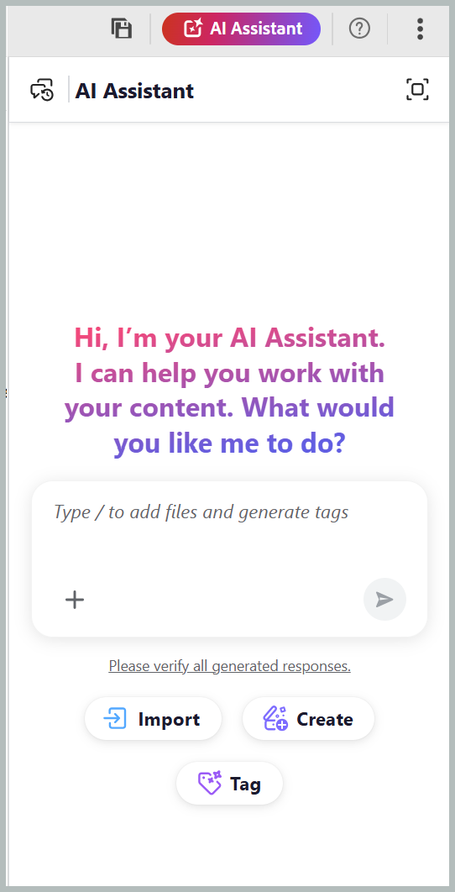{width="650"}

   - **Utilizzo del collegamento**: Digitare `/` nel campo Prompt, quindi scegliere **Aggiungi riferimento archivio** per scegliere un argomento dal repository (oppure **Aggiungi file dal dispositivo** per caricare un argomento dal computer) e immettere un prompt come *Suggerisci tag per un file*.

   - **Trascina**: trascina uno o più argomenti nello spazio dei prompt e immetti un prompt come *Suggerisci tag per un file*.

     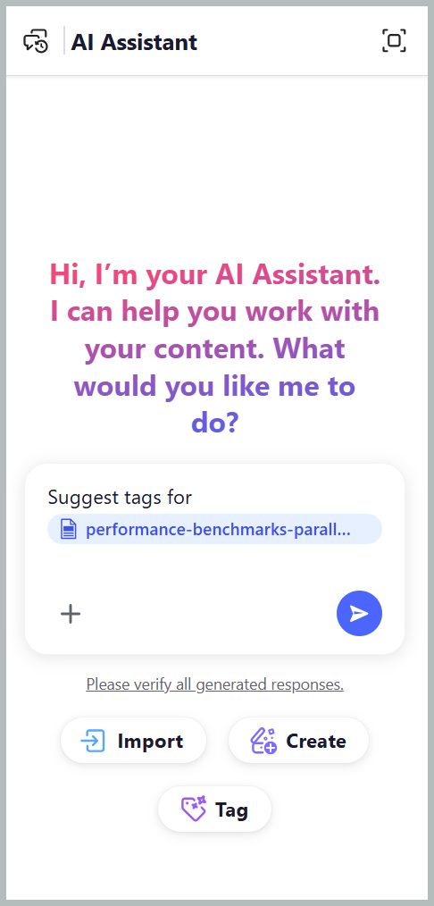{width="650"}

   - **Specificare i percorsi degli argomenti**: digitare `@` seguito dai percorsi separati da virgole per più argomenti della stessa mappa o di mappe diverse e immettere un prompt come *Suggerisci tag per un file*.

     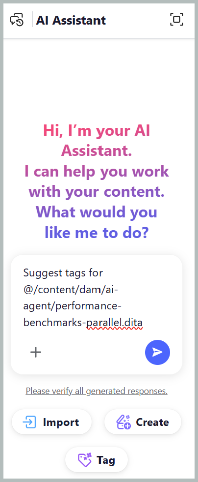{width="650"}

1. Seleziona **Invia**.

1. L’Assistente AI analizza il contenuto dell’argomento e genera consigli sui tag.

   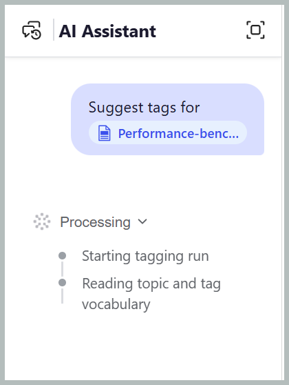{width="650"}

1. Rivedi i tag suggeriti come segue:

   >[!NOTE]
   >
   > Per gli argomenti che contengono già tag, l&#39;Assistente IA visualizza i tag esistenti. Questi tag sono di sola lettura e non possono essere modificati o rimossi.

   - Per un singolo argomento, puoi **Accettare** i consigli per applicarli o **Rifiutarli** se non sono necessari.

     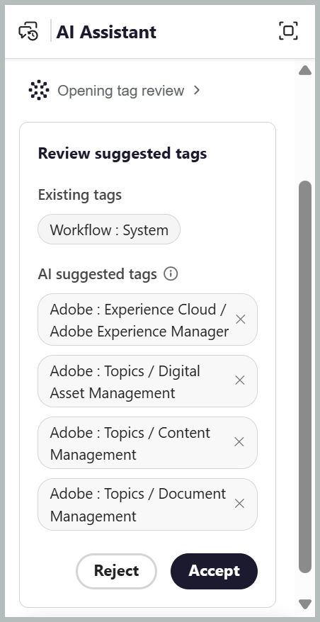{width="650"}

   - Per più argomenti:
     1. Seleziona **Anteprima** per rivedere i consigli sui tag generati da IA.

        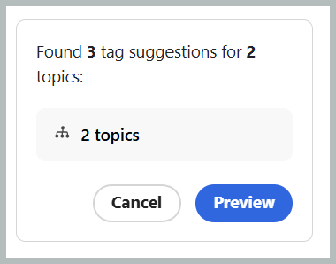{width="650"}

     1. Rivedi i tag suggeriti per ogni argomento, quindi scegli una delle azioni seguenti:
        - **Accetta tutti** per applicare tutti i tag suggeriti per tutti gli argomenti.
        - **Rifiuta tutti** per ignorare tutti i tag suggeriti per tutti gli argomenti.
        - **Cancella tutti i suggerimenti** per rimuovere tutti i tag suggeriti per un argomento specifico.
        - Seleziona l&#39;icona **X** accanto a un tag per rimuovere un singolo suggerimento di tag.

          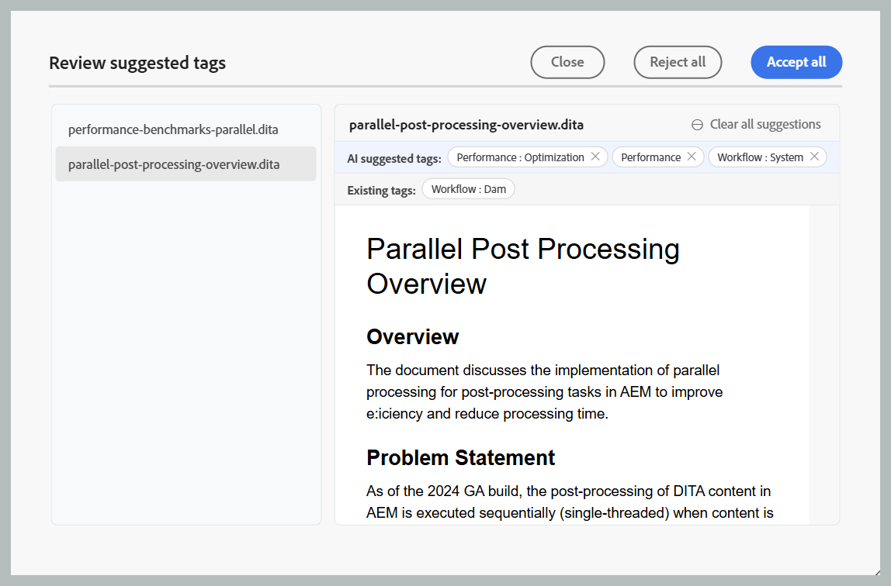{width="650"}

1. Quando accetti i tag suggeriti, l’abilità di assegnazione tag avanzati aggiunge i tag generati dall’intelligenza artificiale ai tag già applicati al contenuto.

Dopo aver completato la revisione, l’Assistente AI visualizza un riepilogo dei tag applicati all’argomento ed eventuali consigli di tag rifiutati.

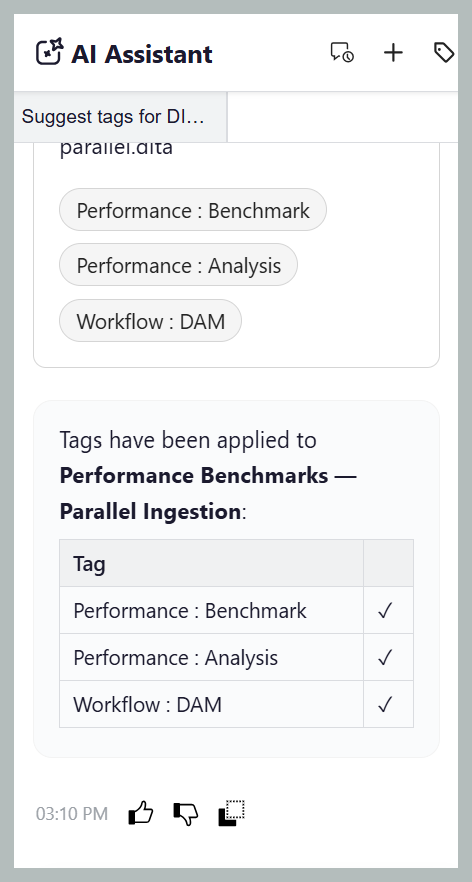{width="650"}

## Applicare tag a più argomenti di una mappa utilizzando l’abilità di assegnazione tag avanzati

Per applicare tag a più argomenti di una mappa con abilità di assegnazione tag avanzati, effettua le seguenti operazioni per utilizzare l’Assistente IA:

1. Accedi a Experience Manager Guides.
1. Nella home page, selezionare **Assistente AI** dalla barra di spostamento. Assicurati che l’Assistente AI in modalità Agentic sia abilitato dall’amministratore.
1. Aggiungi la mappa per la quale desideri generare consigli sui tag utilizzando uno dei seguenti metodi, come descritto per gli argomenti:

   - **Utilizzo di prompt suggeriti**: per la prima chat nell&#39;area Risposta, selezionare **Suggerisci tag per un prompt di file**. Il prompt viene aggiunto automaticamente allo spazio del prompt. Selezionare `[file]`, quindi scegliere la mappa dall&#39;archivio o da una raccolta nella finestra di dialogo **Seleziona file**.

   - **Trascina e rilascia**: trascina una mappa nello spazio dei prompt e immetti un prompt come *Suggerisci tag per un file*.

   - **Utilizzo del collegamento**: Digitare `/` nel campo Prompt, quindi scegliere **Aggiungi riferimento archivio** per scegliere una mappa dal repository (oppure **Aggiungi file dal dispositivo** per caricare una mappa dal computer) e immettere un prompt come *Suggerisci tag per un file*.

     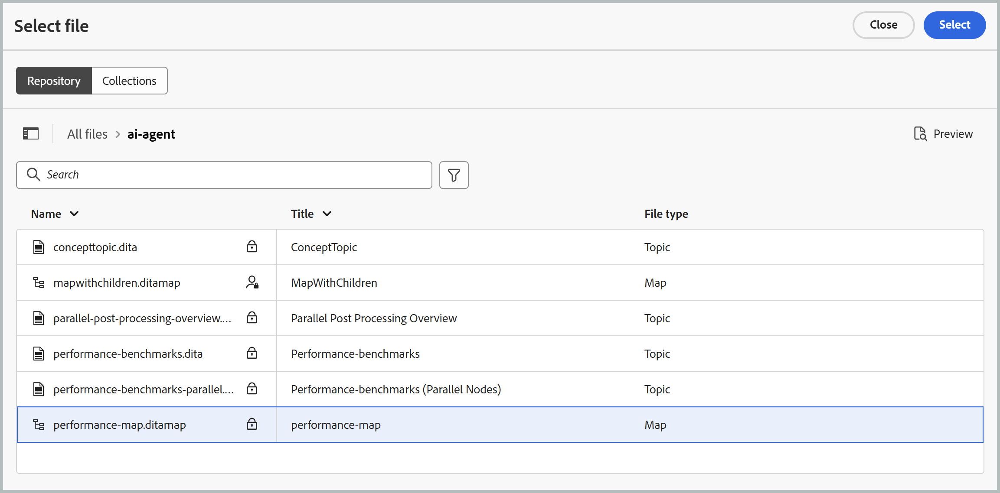{width="650"}

1. Seleziona **Invia**.
Un messaggio indica che la mappa selezionata contiene più argomenti. Seleziona **Seleziona argomenti** per scegliere gli argomenti per i quali desideri assegnare tag ai consigli.

   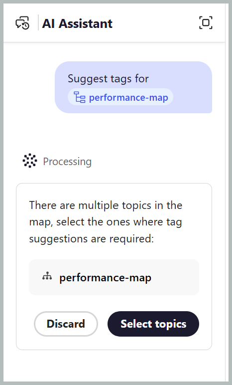{width="650"}

1. Nella finestra di dialogo **Seleziona argomenti**, seleziona gli argomenti per i quali desideri assegnare tag ai consigli.\
   La finestra di dialogo **Seleziona argomenti** fornisce quanto segue:

   - **Elenco argomenti:** visualizza tutti gli argomenti nella mappa selezionata. Seleziona gli argomenti per i quali desideri generare i consigli sui tag.
   - **Riquadro di anteprima:** Visualizza un&#39;anteprima dell&#39;argomento selezionato insieme ai tag esistenti.
   - **Filtro:** Filtra gli argomenti per visualizzare solo quelli con **Tag aggiunti** o **Nessun tag aggiunto**.

     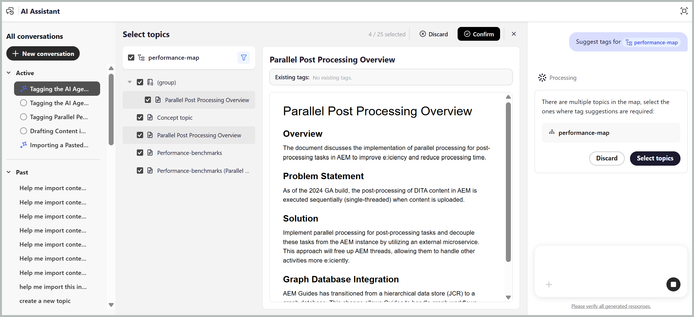{width="650"}

1. Seleziona **Conferma**. L’Assistente AI analizza gli argomenti selezionati e visualizza il numero di consigli sui tag generati per ogni argomento.
1. Seleziona **Anteprima** per rivedere i consigli sui tag generati da IA.
1. Rivedi i tag suggeriti per ogni argomento, quindi scegli una delle azioni seguenti:
   - **Accetta** per applicare tutti i tag suggeriti per tutti gli argomenti.
   - **Rifiuta** per ignorare tutti i tag suggeriti per tutti gli argomenti.
   - **Cancella tutti i suggerimenti** per rimuovere tutti i tag suggeriti per un argomento specifico.
   - Seleziona l&#39;icona **X** accanto a un tag per rimuovere un singolo suggerimento di tag.

     >[!NOTE]
     >
     > Per gli argomenti che contengono già tag, l&#39;Assistente IA visualizza i tag esistenti. Questi tag sono di sola lettura e non possono essere modificati o rimossi.

   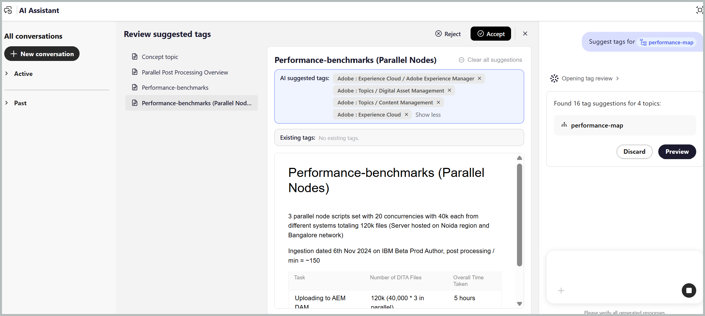{width="650"}

1. Quando accetti i tag suggeriti, l’abilità di assegnazione tag avanzati aggiunge i tag generati dall’intelligenza artificiale ai tag già applicati al contenuto.

Dopo aver completato la revisione, l’Assistente AI visualizza un riepilogo dei tag applicati a ciascun argomento ed eventuali consigli di tag rifiutati.

