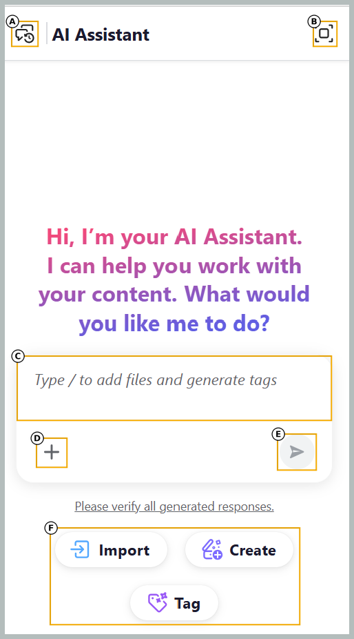
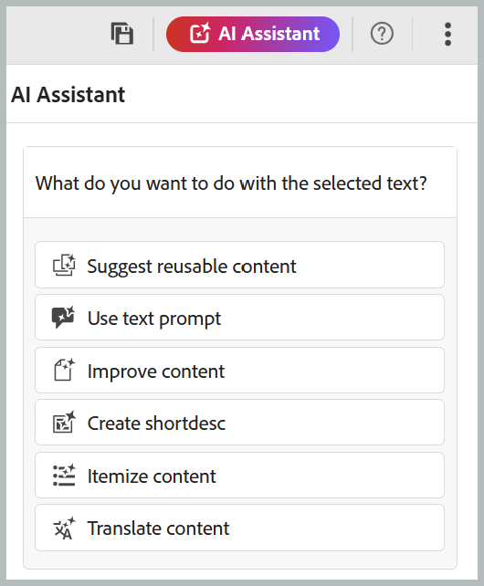

# Assistente IA

>[!NOTE]
>
> La funzione Assistente IA è attualmente disponibile per Adobe Experience Manager Guides as a Cloud Service.

L’Assistente per l’intelligenza artificiale in Adobe Experience Manager Guides è uno strumento basato sull’intelligenza artificiale progettato per migliorare la produttività semplificando la creazione, la gestione e i flussi di lavoro di authoring dei contenuti. Offre due modalità: Agentic e Standard. In modalità **Agentic**, l&#39;Assistente AI consente di eseguire attività relative ai contenuti tramite interazioni in linguaggio naturale, con competenze quali importazione, creazione e assegnazione di tag avanzati per semplificare la creazione di contenuti, l&#39;organizzazione e la gestione dei metadati. In **modalità standard**, l&#39;Assistente AI fornisce assistenza per l&#39;authoring che consente di creare, perfezionare e gestire i contenuti in modo più efficiente.

## Modalità Assistente AI

L&#39;Assistente IA è disponibile in due modalità: **Agentic** e **Standard**. Gli amministratori possono selezionare la modalità dalla sezione **Funzioni IA** della scheda **Generale** in **Impostazioni Workspace**. Il pannello Assistente IA nell’editor rimane lo stesso in entrambe le modalità, ma le funzionalità disponibili sono diverse:

- **Modalità agente:** utilizza le abilità **Importa**, **Crea** e **Tag avanzati** per convertire i file in argomenti strutturati, creare la prima bozza di contenuto e consigliare tag rilevanti in base alla tassonomia della tua organizzazione.
- **Modalità standard:** fornisce assistenza per l&#39;authoring basato sull&#39;intelligenza artificiale tramite azioni contestuali, quali il riutilizzo, la traduzione e i miglioramenti della qualità dei contenuti, per semplificare i flussi di lavoro di authoring.

## Modalità agente

>[!NOTE]
>
> Per utilizzare l’Assistente AI in modalità Agentic, l’organizzazione deve effettuare l’onboarding in Adobe CX Enterprise Coworker e disporre dei crediti disponibili. Una volta effettuato l’onboarding, contatta il team di successo del cliente per abilitare la funzione. Per informazioni dettagliate sulla configurazione, visualizzare [Configurare l&#39;Assistente di IA in modalità agente](../install-conf-guide/configure-ai-assistant-agentic-mode-cs.md).

La modalità Agentic nell’Assistente AI consente di eseguire un’ampia gamma di attività relative ai contenuti attraverso interazioni in linguaggio naturale, come la creazione e l’importazione di contenuti, il riepilogo degli argomenti, l’aggiunta di argomenti alle mappe e la gestione dei metadati. Puoi descrivere i tuoi requisiti nel pannello chat e AI Assistant pianifica ed esegue le attività fornendo visibilità sul loro avanzamento. La modalità Agentic consente di accedere rapidamente alle seguenti competenze:

- **Importa**: converte i file PDF, Word o Markdown dal dispositivo o dall&#39;archivio dei contenuti in argomenti strutturati. Per ulteriori dettagli, visualizza [Importa contenuto con l&#39;Assistente di IA](./import-ai-assistant.md).

- **Crea**: genera argomenti e mappe bozza da materiali di input quali specifiche, immagini di lavagna, schermate e altro contenuto di riferimento, con la possibilità di utilizzare il contenuto esistente per il tono e lo stile. Per ulteriori dettagli, visualizzare [Crea contenuto con Assistente IA](./create-ai-assistant.md).

- **Applicazione di tag avanzati**: consiglia tag rilevanti per gli argomenti in base alla tassonomia dell&#39;organizzazione per migliorare la coerenza dei metadati. Per ulteriori dettagli, visualizza [Applicazione di tag avanzati con l&#39;Assistente AI](./ai-assistant-agentic.md).

I seguenti componenti del pannello Assistente IA consentono di aggiungere contenuto, immettere prompt e avviare attività:

- **(A)** Cronologia conversazioni: visualizza e riapre le conversazioni precedenti per esaminare le richieste e le risposte precedenti.
- **(B)** Schermo intero: espande il pannello dell&#39;Assistente AI a schermo intero.
- **(C)** Spazio del prompt: immettere una richiesta di prompt oppure digitare `/` per aggiungere file e generare tag.
- **(D)** Allega file o aggiungi contesto: aggiunge argomenti, mappe o file dal sistema locale per fornire il contenuto con cui funziona l&#39;Assistente IA.
- **(E)** Invia: invia la richiesta e il contenuto allegato all&#39;Assistente IA.
- **(F)** Azioni rapide: Avvia un&#39;attività direttamente da uno dei seguenti collegamenti: **Importa**, **Crea** o **Tag**.

## Modalità standard

La modalità standard rende il processo di authoring più intelligente e veloce. Quando selezioni il testo nell’Editor, l’Assistente AI offre azioni rapide, ad esempio la generazione di suggerimenti intelligenti per il riutilizzo dei contenuti, la traduzione dei contenuti, il miglioramento della qualità dei contenuti e altro ancora, tutto in base al contenuto selezionato. Questo migliora l’esperienza complessiva di authoring e la produttività degli autori.

Per ulteriori dettagli, visualizzare [Documenti di authoring con Assistente AI](./ai-assistant-right-panel.md).

## Introduzione all’Assistente IA

Quando si utilizza **Assistente IA** per la prima volta, viene richiesto di inviare il consenso prima di utilizzare le funzionalità di IA generativa di Experience Manager Guides.

Per avviare l’Assistente IA, effettua le seguenti operazioni:

1. Accedi a Experience Manager Guides.
1. Nella home page, selezionare **Assistente AI** dall&#39;alto. Assicurati che l’amministratore abbia abilitato la funzione Assistente AI nella modalità desiderata.

L&#39;Assistente AI visualizza le funzionalità chiave, il collegamento alle linee guida utente e un pulsante **Inizia**.
Leggere attentamente le linee guida per l&#39;utente, quindi selezionare **Inizia** per avviare l&#39;Assistente IA.

>[!NOTE]
>
>Se si è già acconsentito alle linee guida per l&#39;utilizzo della funzione Assistente risorse, non verrà richiesto nuovamente il consenso e sarà possibile continuare a utilizzare la funzione Assistente risorse di intelligenza artificiale.

**Argomenti correlati**

[Domande frequenti sulla sicurezza di Assistente IA](./ai-assistant-faq.md)

[Comunicazioni di Adobe Experience Manager Guides Generative AI](./adobe-generative-ai-disclosures.md)

[Configurare l’Assistente AI per la guida e l’authoring avanzati](../cs-install-guide/conf-smart-suggestions.md)
