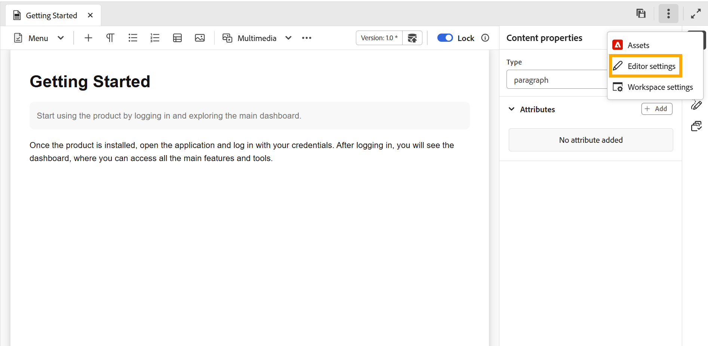
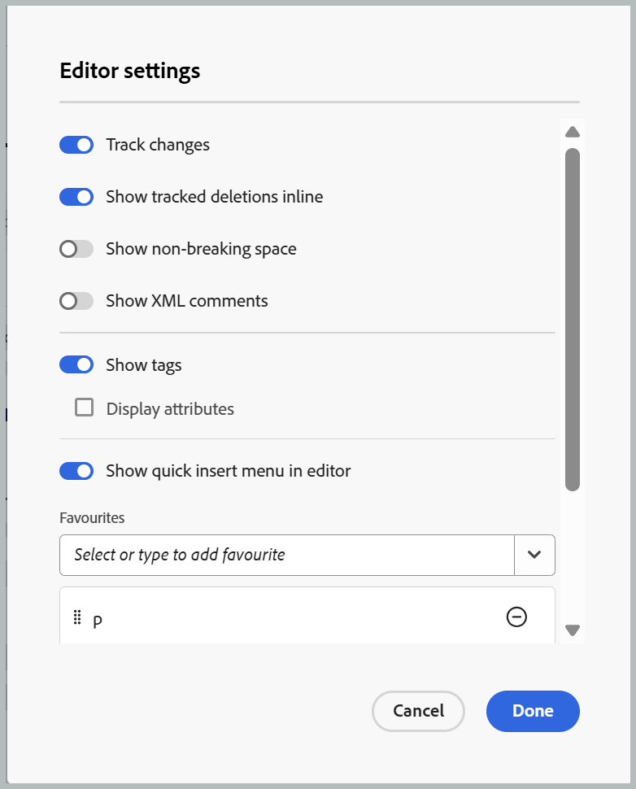
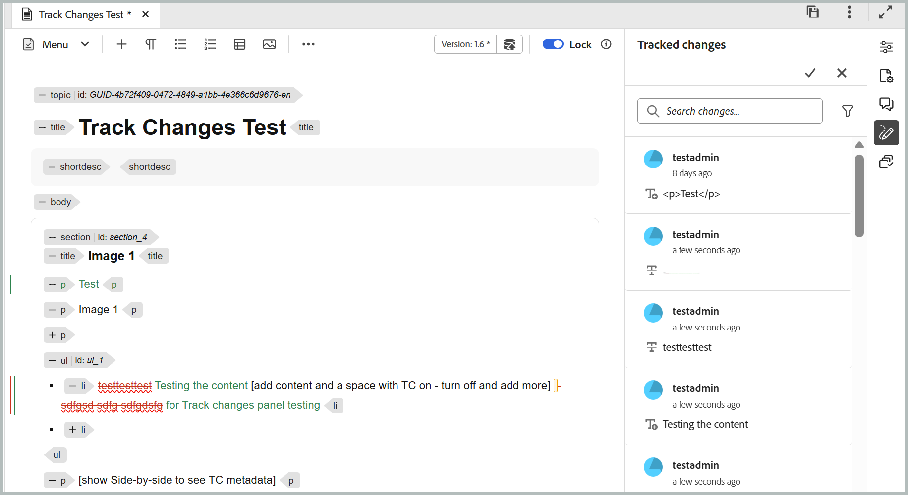
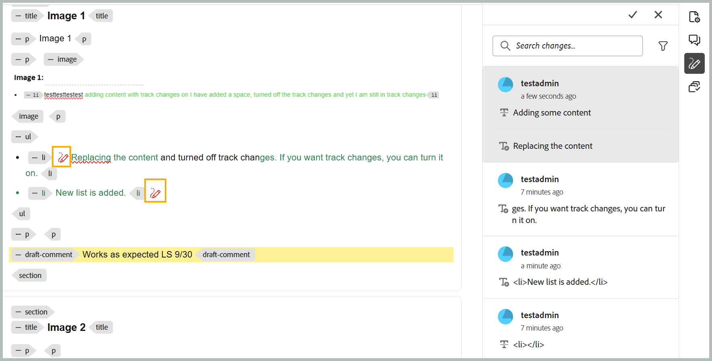
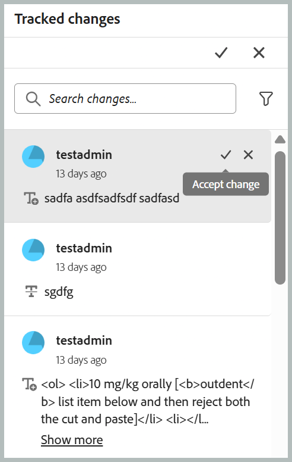
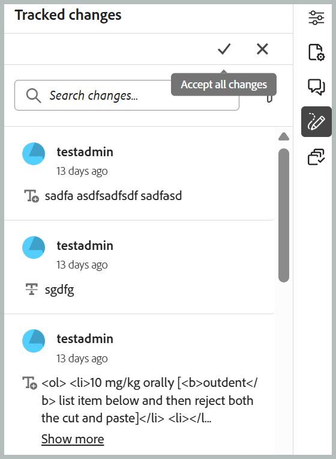
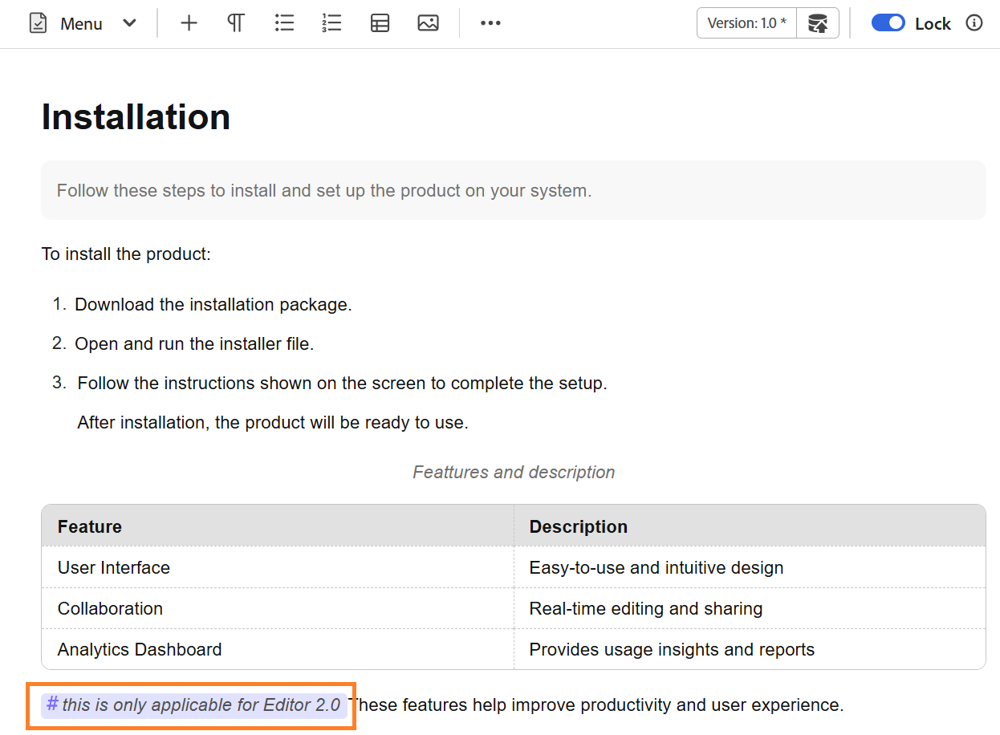
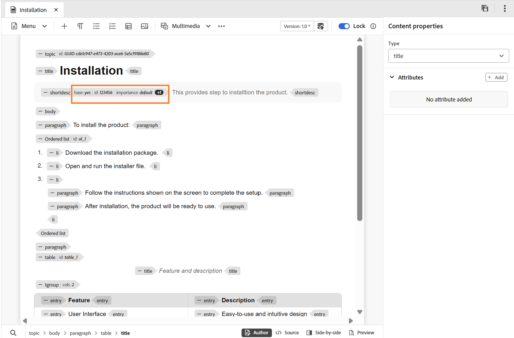
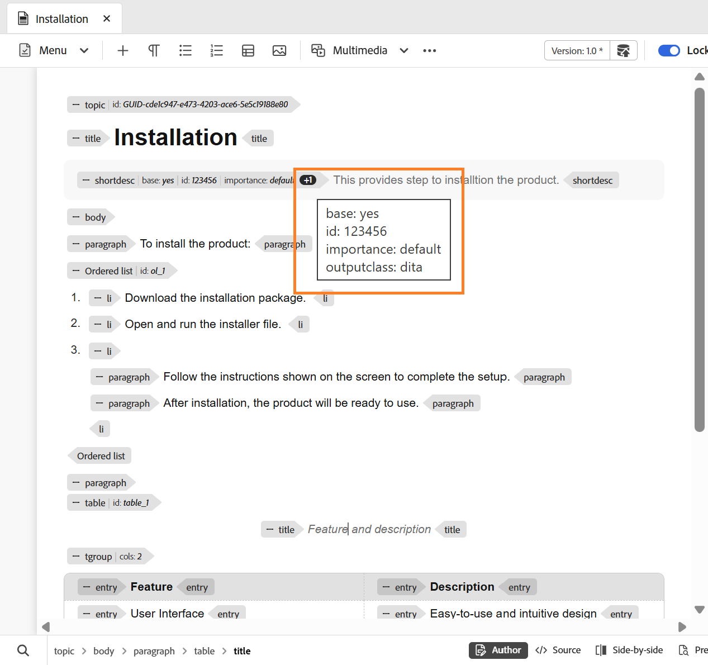
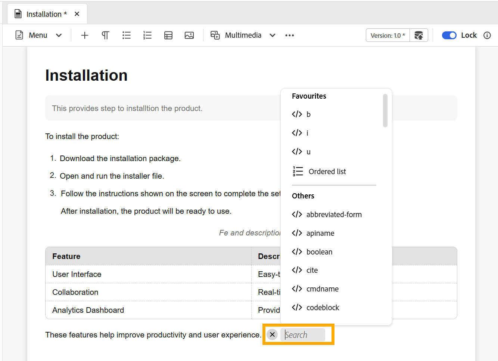

# Impostazioni editor

>[!NOTE]
>
> Questo articolo si applica solo al nuovo editor. Per abilitare questa funzionalità nel tuo ambiente, contatta il team Customer Success di AEM Guides.

Le impostazioni dell’editor forniscono un pannello di configurazione centralizzato che consente di personalizzare il comportamento dell’editor a livello di singolo autore. Offre maggiore flessibilità, coerenza e controllo durante il processo di authoring.

Questo pannello di impostazioni centralizzato consente di gestire le principali preferenze dell’editor da un’unica posizione, riducendo la necessità di configurazioni sparse o manuali. È possibile accedere alle impostazioni dell&#39;editor dalle **Altre azioni** nella barra della scheda.

{width="650"}

## Opzioni di configurazione supportate

Le impostazioni dell’editor consentono di personalizzare varie opzioni, tra cui Revisioni, Mostra tag, Menu di inserimento rapido e altro in base alle preferenze.

{width="350"}

### Rileva modifiche

>[!NOTE]
>
>- Questa funzione è abilitata per impostazione predefinita. Per disabilitarla, contatta il team Customer Success di AEM Guides.
>- Quando si lavora con le tabelle, si tiene traccia dell’inserimento di una riga o colonna, ma non dell’eliminazione di una riga o colonna nel pannello Rileva modifiche.

Abilita la modalità **Rileva modifiche** per registrare le modifiche apportate a un argomento. Una volta abilitata, ogni inserimento ed eliminazione viene acquisita mentre si lavora e tutte le modifiche sono elencate nel pannello **Rileva modifiche**. Le modifiche consecutive apportate nella stessa posizione vengono raggruppate e visualizzate come una singola modifica nel pannello **Rileva modifiche**.

Il contenuto eliminato viene visualizzato barrato, mentre il contenuto inserito viene visualizzato in verde. Inoltre, le barre di modifica vengono visualizzate lungo il bordo della pagina dell&#39;argomento, con barre rosse che indicano il contenuto eliminato e barre verdi che indicano il contenuto aggiunto. Se una linea contiene sia aggiunte che eliminazioni, vengono visualizzate entrambe le barre di modifica.

Quando più utenti lavorano sullo stesso argomento, la funzione Revisioni consente loro di visualizzare le modifiche degli altri utenti. Quando il contenuto è pronto per essere finalizzato, gli utenti possono rivedere le revisioni e accettarle o rifiutarle.

{width="350"}

**Mostra eliminazioni rilevate in linea**

Controlla la modalità di visualizzazione del contenuto eliminato nell&#39;editor quando è attiva la funzione Rileva modifiche. Quando questa opzione è attivata, il contenuto eliminato rimane visibile in linea, nella posizione originale, come testo barrato. Se è disabilitata, il contenuto eliminato non viene visualizzato. Al contrario, nel punto in cui è stato rimosso il contenuto viene visualizzata un’icona a forma di matita che offre una visualizzazione più chiara dell’argomento. Seleziona l’icona a forma di matita per passare al contenuto eliminato corrispondente nel pannello Tracked changes (Modifiche tracciate).

{width="350"}

**Accettare o rifiutare le revisioni**

Per rivedere le modifiche, seleziona l&#39;icona **Rileva modifiche** nel pannello a destra per aprire il pannello Modifiche rilevate ed eseguire i passaggi seguenti:

1. Seleziona una revisione nel pannello. Il contenuto modificato viene selezionato nel documento.
1. Accettare la modifica selezionando l&#39;icona **Accetta modifica** oppure rifiutarla selezionando l&#39;icona **Rifiuta modifica**.

   {width="650"}

1. Per accettare o rifiutare tutte le modifiche con un solo clic, seleziona **Accetta tutte le modifiche** o **Rifiuta tutte le modifiche** dalla parte superiore del pannello.

   {width="650"}

### Spazi unificatori

Abilita questa opzione per mostrare un indicatore per gli spazi unificatori durante la modifica nell’editor. È visibile solo nella visualizzazione Autore per l&#39;argomento e le mappe DITA.

### Commenti XML

Consente agli autori di visualizzare, modificare e inserire commenti XML direttamente in modalità Autore, per una migliore visibilità all&#39;interno del contenuto. Quando questa opzione è abilitata, gli autori possono visualizzare, inserire, modificare ed eliminare commenti XML direttamente all’interno del contenuto nella modalità Autore, semplificando l’aggiunta di note contestuali per i collaboratori. Se l&#39;opzione è disattivata, i commenti XML vengono nascosti in modalità di creazione e non possono essere inseriti o modificati dalla modalità di creazione, garantendo un&#39;esperienza di creazione più pulita per gli utenti che non li richiedono. È possibile continuare a visualizzare e creare commenti XML in modalità di origine utilizzando la sintassi `<!-- test comment -->`.

>[!NOTE]
>
> Per i commenti XML, **Rileva modifiche** registra solo l&#39;inserimento o l&#39;eliminazione dell&#39;intero commento. Le modifiche apportate all&#39;interno di un commento XML esistente non vengono registrate.

{width="650"}

### Tag

Controlla la visibilità dei tag nell&#39;editor. Quando questa opzione è attivata, i tag strutturali vengono visualizzati all&#39;interno del contenuto, consentendo agli autori di visualizzare e gestire la struttura DITA sottostante. Se disabilitati, questi tag sono nascosti per fornire un’esperienza di authoring più pulita e mirata.

{width="650"}

Quando le impostazioni **Mostra tag** sono abilitate, è possibile abilitare **Visualizza attributi** per visualizzare e convalidare gli attributi associati a un elemento. Quando a un elemento sono associati più di tre attributi, viene visualizzato un indicatore di conteggio. Passando il puntatore del mouse sull&#39;indicatore viene visualizzato l&#39;elenco completo degli attributi applicati all&#39;elemento.

     {width=&quot;650&quot;}

### Menu di inserimento rapido nell’editor

Consente di aggiungere elementi direttamente durante la modifica in modalità Autore in corrispondenza della posizione del cursore senza passare alla barra degli strumenti. Gli elementi utilizzati di frequente possono anche essere configurati nei **Preferiti** per un accesso più rapido. Il menu di inserimento rapido è disponibile direttamente nell&#39;editor quando si preme **Ctrl + /** su Windows o **Comando + /** su macOS nella posizione del cursore.

{width="650"}

È possibile cercare e aggiungere elementi ai Preferiti, rimuovere eventuali elementi aggiunti in precedenza e ridisporli con una semplice azione di trascinamento. I Preferiti includono gli elementi utilizzati più di frequente e l&#39;ordine impostato in questo punto viene visualizzato nel menu Inserimento rapido quando si accede dall&#39;editor.

Breve video su come utilizzare il menu Inserimento rapido nel nuovo editor.

>[!VIDEO](https://video.tv.adobe.com/v/3491343)

