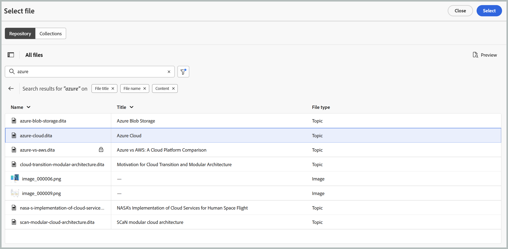
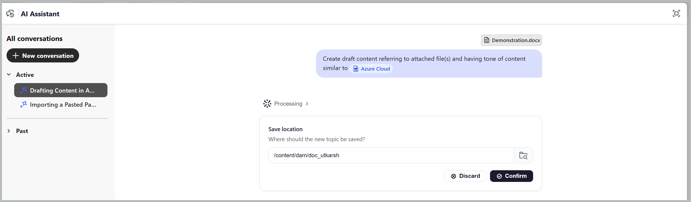
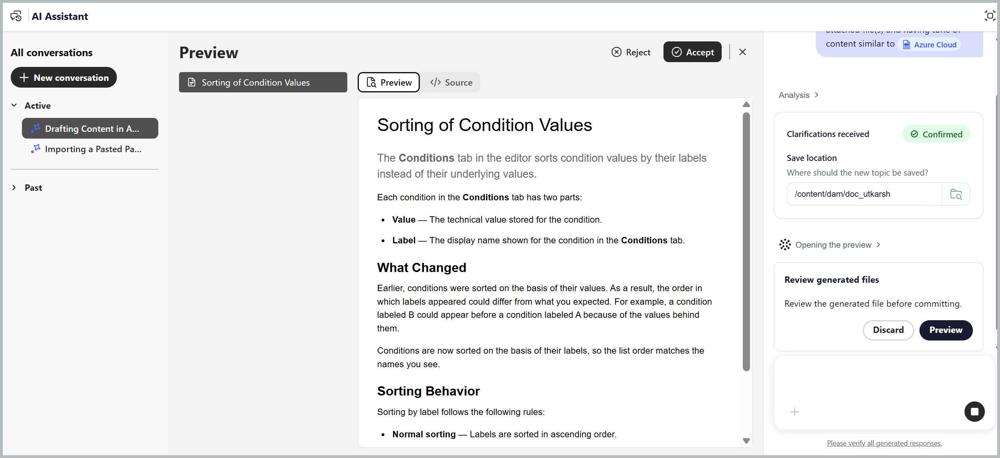
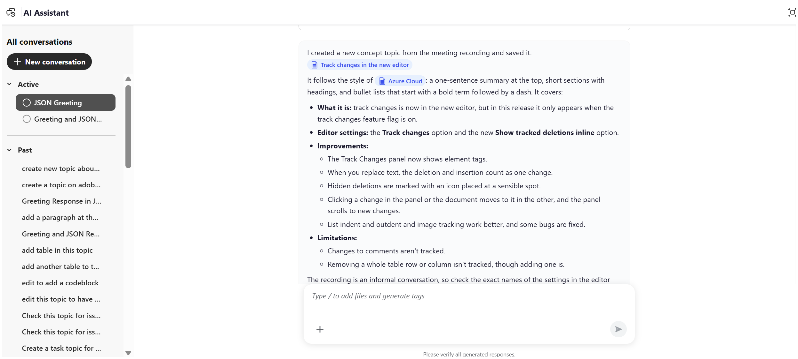
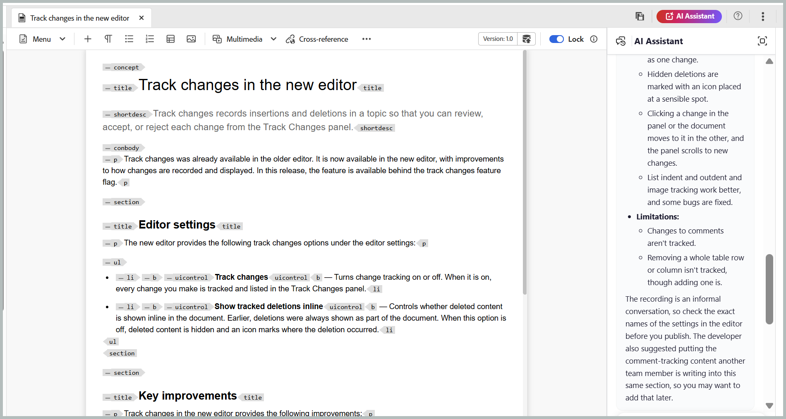
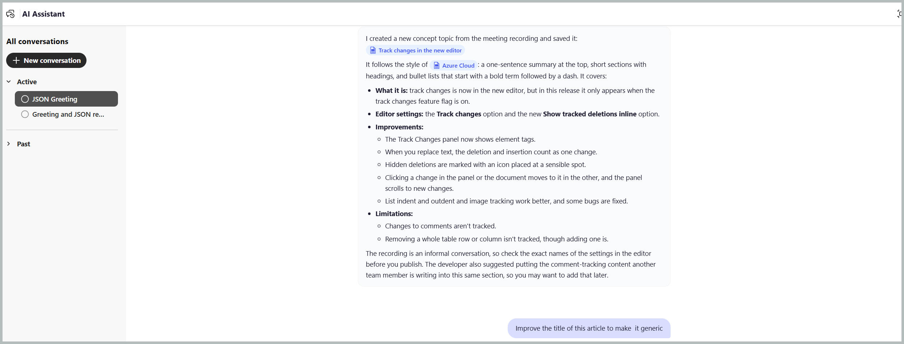
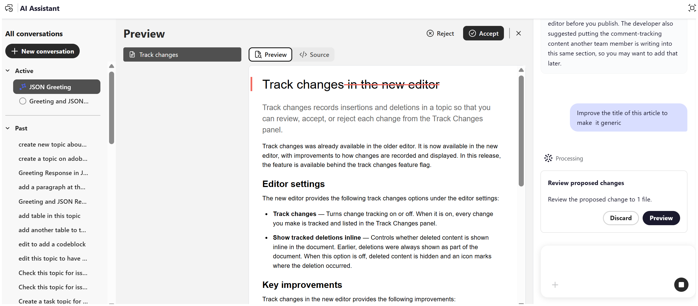
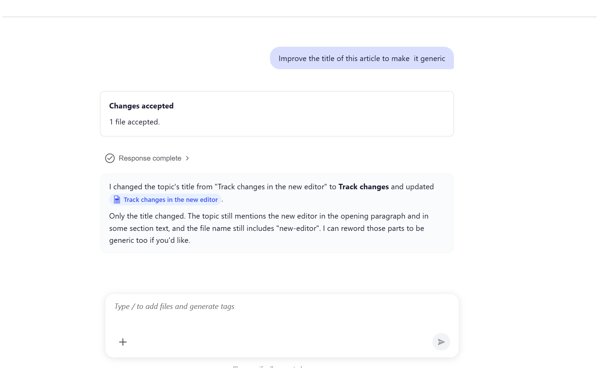

# Creare la prima bozza del contenuto

L&#39;abilità **Crea** nella modalità Agentic dell&#39;Assistente di intelligenza artificiale consente di generare la prima bozza di contenuto strutturato da note, specifiche, immagini della lavagna, schermate o altro materiale di riferimento disponibile. L&#39;abilità identifica automaticamente il tipo di argomento DITA appropriato, ad esempio Concetto, Attività, Riferimento o Risoluzione dei problemi, in base al contenuto e ai modelli di argomento disponibili nell&#39;archivio, riducendo lo sforzo manuale necessario per strutturare e creare il contenuto.

È possibile allegare un file, selezionare un file esistente come riferimento per il tono e lo stile e specificare la cartella in cui si desidera salvare il contenuto generato. Per creare la prima bozza del contenuto desiderato, effettua le seguenti operazioni:

1. Accedi a Experience Manager Guides.
1. Nella home page, selezionare **Assistente AI** dalla barra di spostamento. Verificare che l&#39;Assistente di [IA in modalità agente](../install-conf-guide/workspace-settings.md) sia abilitato dall&#39;amministratore.

1. Seleziona **Crea** dal pannello dell&#39;Assistente AI.

   Il prompt iniziale viene visualizzato nella casella di richiesta: *Crea contenuto bozza che fa riferimento ai file allegati e ha un tono di contenuto simile a [file]*

1. Allegare le note, le specifiche o altri file di riferimento al prompt utilizzando uno dei metodi seguenti:

   - **Utilizzo del collegamento**: digitare `/` nel campo Prompt, quindi scegliere **Aggiungi riferimento archivio** per scegliere il file dal repository (oppure **Aggiungi file dal dispositivo** per caricare il file dal computer).

   - **Utilizzo dell&#39;icona Allega file o aggiungi contesto (+)**: aggiunge file dal sistema locale.

   - **Trascina e rilascia**: trascina il file che desideri creare dal sistema direttamente nello spazio dei prompt.

1. *(Facoltativo)* Nel prompt iniziale, selezionare `[file]`. Selezionate l&#39;argomento esistente di cui desiderate che il tono corrisponda alla bozza. È possibile scegliere l&#39;argomento dal repository o da una raccolta. Il nome dell&#39;argomento sostituisce `[file]` nel prompt.

   {width="350"}

1. Seleziona **Invia**.

   L’Assistente AI analizza il contenuto ed elenca ogni passaggio che completa.

1. Rispondi a eventuali domande successive dell’Assistente AI per fornire i dettagli necessari per generare il contenuto.

   {width="350"}

1. Seleziona **Anteprima** per rivedere l&#39;argomento generato.

   Confrontare ogni bozza con il materiale di origine e i tipi di argomento richiesti.

   

1. Selezionare una delle opzioni seguenti:

   - **Accetta** per salvare l&#39;argomento nella cartella confermata
   - **Rifiuta** per ignorare le modifiche senza salvare nulla. È possibile specificare un motivo per il rifiuto del contenuto della bozza e immettere un messaggio di richiesta specificando le modifiche desiderate. L’Assistente AI utilizza il tuo feedback per rivedere il contenuto della bozza.

     L’argomento è ora disponibile nel tuo archivio.

     

Dopo che l’Assistente AI crea un argomento, puoi aprirlo nell’Editor e perfezionare il contenuto utilizzando le istruzioni di follow-up. In questo modo è possibile migliorare l’argomento in modo iterativo senza iniziare una nuova conversazione. Ogni modifica proposta viene visualizzata nell&#39;anteprima con **Revisioni** abilitate, consentendo di rivedere le modifiche prima di applicarle.

Ad esempio, per perfezionare il titolo di un argomento generato:

1. Apri l’argomento appena creato nell’Editor dalla finestra di dialogo Assistente IA.

   

1. Nel pannello Assistente AI, immetti un prompt di completamento, ad esempio `Improve the title of this topic to make it generic.`

   

1. Seleziona **Invia**.

   L’Assistente AI analizza e suggerisce un nuovo titolo.

1. Seleziona **Anteprima** per rivedere le modifiche proposte.

   L’anteprima mostra il titolo modificato con le revisioni, evidenziando ciò che è stato modificato.

   

1. Seleziona **Accetta** per applicare le modifiche all&#39;argomento.

   

È possibile continuare a perfezionare altri elementi dell&#39;argomento, ad esempio paragrafi, passaggi o tabelle, fornendo ulteriori prompt nella stessa conversazione.

