# Creare e gestire rami di una mappa DITA

In Experience Manager Guides è possibile creare più rami di una mappa DITA per gestire la documentazione per diverse versioni, funzionalità o correzioni. Puoi passare da un ramo all’altro per lavorare sul contenuto associato, archiviare i rami che non sono più necessari e ripristinarli quando necessario.

È inoltre possibile creare un ramo da qualsiasi ramo esistente della stessa mappa DITA.

## Creare un ramo

È possibile creare un ramo di una mappa DITA per lavorare sulle modifiche apportate alla documentazione senza influire sul contenuto corrispondente in altri rami.

Per creare un ramo, effettua le seguenti operazioni:

1. Aprire la mappa DITA per la quale si desidera creare un ramo.

   >[!NOTE]
   >
   > Se nell’editor è già aperta un’altra mappa, viene visualizzata una finestra di dialogo di conferma. Seleziona **Apri** per aprire la mappa selezionata nel ramo corrente. Per ulteriori informazioni, visualizzare [Aprire il contenuto al di fuori del contesto della mappa corrente](#open-content-outside-the-current-map-context).

1. Seleziona il menu a discesa del ramo **main** e verifica che sia selezionata la mappa DITA richiesta.

   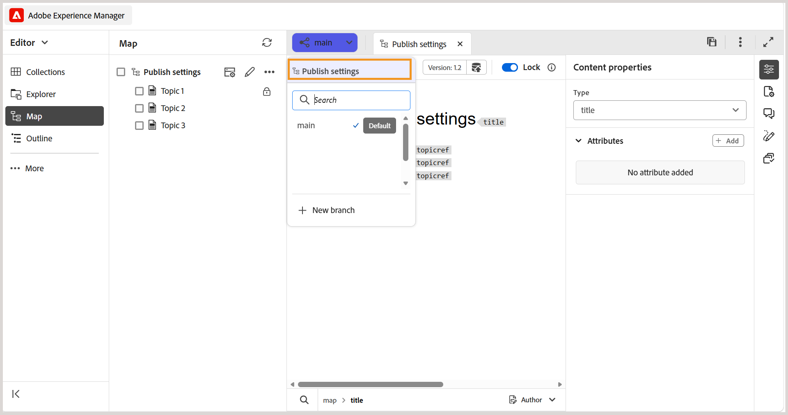

1. Seleziona **Nuovo ramo** per creare un ramo della mappa selezionata.

1. Nella finestra di dialogo **Nuovo ramo**, immetti un nome per il nuovo ramo e seleziona il ramo principale da cui desideri crearlo.

   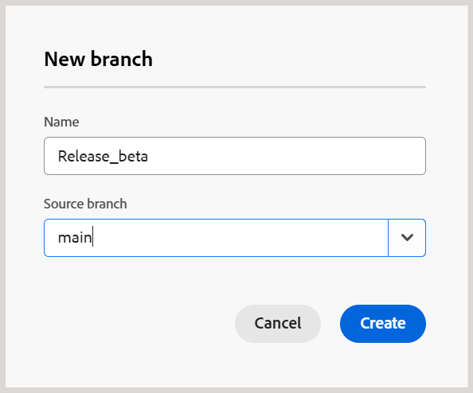

1. Seleziona **Crea**.

Viene creato un nuovo ramo per la mappa DITA selezionata. Ora puoi passare al nuovo ramo e iniziare a lavorare sul relativo contenuto associato.

## Passa da un ramo all’altro

Per cambiare ramo, effettua le seguenti operazioni:

1. Seleziona il menu a discesa **branch** nella parte superiore dell&#39;editor (che visualizza `main` per impostazione predefinita). Viene visualizzato l&#39;elenco dei rami disponibili per la mappa DITA selezionata.
1. Seleziona il ramo con cui desideri lavorare.

   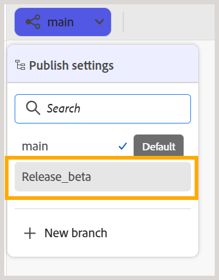

   Il ramo selezionato viene aperto e il relativo nome viene visualizzato nel menu a discesa del ramo nella parte superiore dell&#39;editor, sostituendo **main**.

   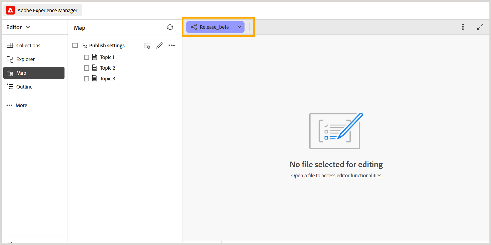

Ora puoi lavorare sulla mappa e sul relativo contenuto associato all’interno del ramo selezionato.

>[!NOTE]
>
>Se in un argomento sono presenti modifiche non salvate quando si cambia ramo, viene visualizzata una finestra di dialogo in cui viene richiesto di salvare le modifiche prima di passare al ramo selezionato.

Ora puoi lavorare sulla mappa e sul relativo contenuto associato all’interno del ramo selezionato.

## Modifica isolata in un ramo

Quando si lavora in un ramo di una mappa DITA, le modifiche apportate al relativo contenuto rimangono all&#39;interno del ramo selezionato e non influiscono sul contenuto corrispondente in altri rami. Questo consente a più autori di lavorare sugli stessi argomenti in modo indipendente tra i diversi rami di una mappa.

Per impostazione predefinita, gli argomenti non modificati vengono letti dal ramo di origine o da `main`. Quando si modifica un argomento nel ramo selezionato, questo diventa parte di quel ramo. Eventuali modifiche successive apportate all&#39;argomento rimangono nel ramo selezionato.

È possibile passare da un ramo all&#39;altro della stessa mappa DITA per visualizzare e modificare il relativo contenuto.

### Modificare gli argomenti di un ramo

È possibile modificare gli argomenti associati a una mappa DITA nel ramo selezionato senza influire sul contenuto in altri rami.

Per modificare un argomento, effettua le seguenti operazioni:

1. Aprire la mappa DITA nell&#39;Editor.
2. Dal menu a discesa del ramo, seleziona il ramo in cui desideri modificare l’argomento.
3. Aprire l&#39;argomento che si desidera modificare dalla mappa.
4. Apporta le modifiche necessarie all&#39;argomento.
5. Salva le modifiche.

   Nel ramo selezionato viene salvata una copia dell&#39;argomento modificato. L’argomento corrispondente negli altri rami rimane invariato.

Puoi continuare a modificare l’argomento nel ramo selezionato o passare a un altro ramo per lavorare sul suo contenuto.

### Apri una mappa al di fuori del contesto della mappa corrente

In Experience Manager Guides, **contesto mappa** fa riferimento alla mappa DITA attualmente aperta nell&#39;editor.

Se tenti di aprire una mappa, un argomento o una risorsa che non fa parte del contesto della mappa corrente, viene visualizzata una finestra di dialogo di conferma con le seguenti opzioni:

- **Apri:** sostituisce il contesto della mappa corrente con il contenuto selezionato.
- **Apri nell&#39;editor:** Apre il contenuto in una nuova scheda senza modificare il contesto della mappa corrente.
- **Annulla:** Annulla l&#39;operazione e mantiene il contesto di mapping corrente.

Consideriamo ad esempio che `master_map.ditamap` è attualmente selezionato nel ramo **main**.

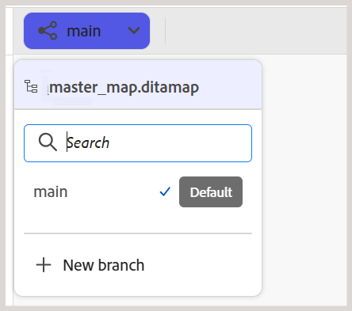

Se si tenta di aprire un&#39;altra mappa DITA, viene visualizzata la seguente finestra di dialogo di conferma:

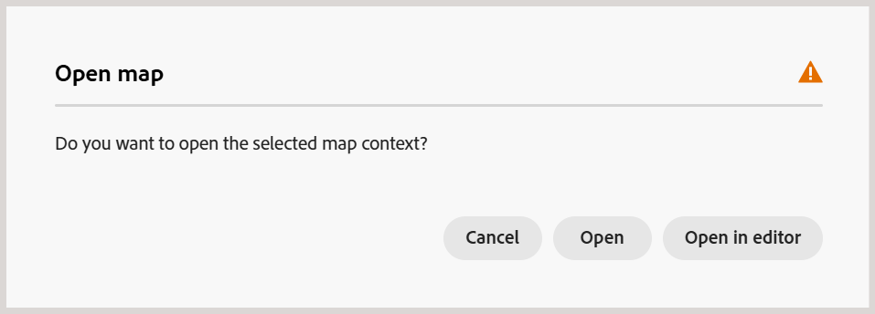

Seleziona **Apri** per passare alla mappa selezionata.

Il contesto della mappa del ramo `main` è stato aggiornato alla mappa appena selezionata, consentendo di lavorare con il relativo contenuto associato.

### Apri o modifica argomenti al di fuori del contesto della mappa corrente

Gli argomenti ai quali non viene fatto riferimento dalla mappa non sono automaticamente disponibili nel ramo.

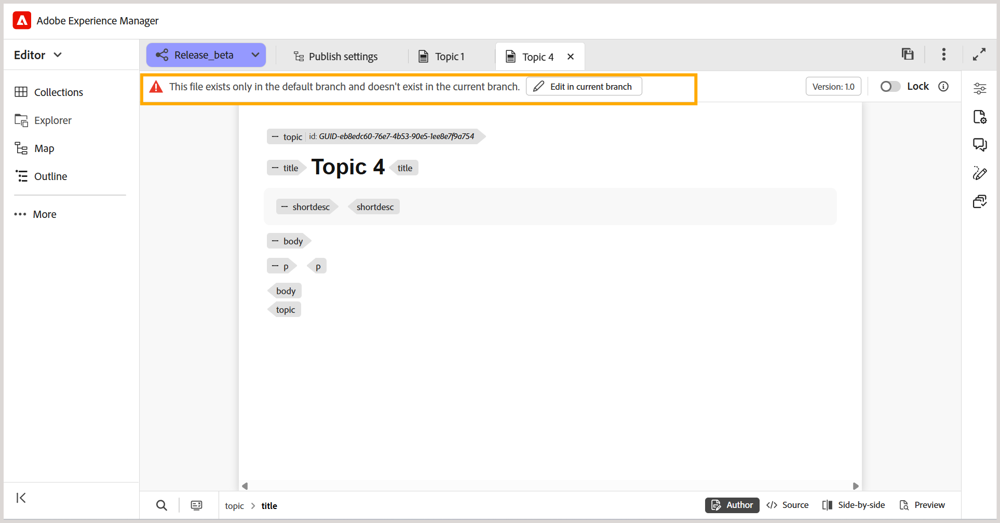

Seleziona **Modifica nel ramo corrente** per rendere tali argomenti disponibili per la modifica nel ramo selezionato.

È ora possibile modificare l&#39;argomento senza modificarne il contenuto in `main`. Tuttavia, l&#39;argomento non viene aggiunto automaticamente alla mappa DITA associata e non viene incluso nell&#39;output pubblicato. Per includere l&#39;argomento nell&#39;output, aggiungerlo alla mappa DITA.

## Gestisci rami

Puoi gestire i rami di una mappa DITA dal pannello **Rami** nella console Mappa. Puoi visualizzare i rami disponibili, creare nuovi rami, unire o rinominare rami esistenti e archiviare rami non più utilizzati attivamente.

Nel pannello **Rami** sono elencati tutti i rami disponibili per la mappa DITA selezionata.

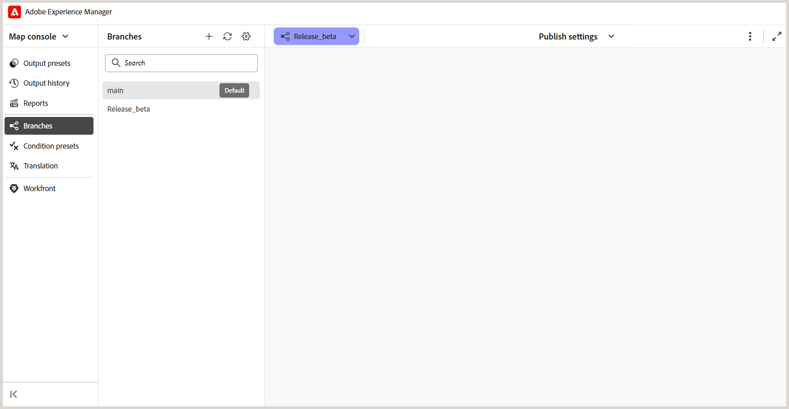

Per gestire un ramo, passa il cursore sul ramo richiesto e seleziona il menu **Opzioni**. Sono disponibili le seguenti azioni:

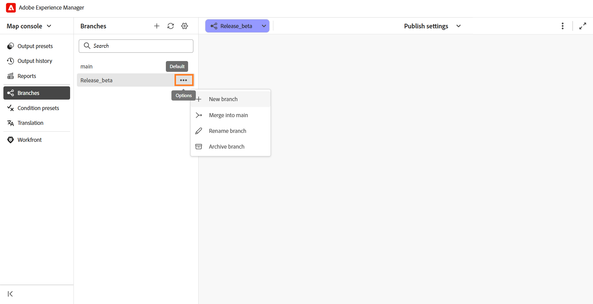

- **Nuovo ramo:** Crea un nuovo ramo dal ramo selezionato.
- **Unisci in principale:** [Unisci le modifiche](./merge-branches.md) dal ramo selezionato al ramo `main`.
- **Rinomina ramo:** Modifica il nome del ramo selezionato.
- **Cronologia unione:** Visualizza una cronologia delle attività di unione. Questa opzione è disponibile solo dopo la creazione di una richiesta di unione.
- **Ramo archivio:** Archivia un ramo non più utilizzato attivamente.

  >[!NOTE]
  >
  > Experience Manager Guides non supporta l’eliminazione di rami. Puoi archiviare i rami non più utilizzati attivamente.

Puoi inoltre utilizzare le opzioni nella parte superiore del pannello **Rami** per cercare un ramo, aggiornare l&#39;elenco dei rami o creare un nuovo ramo.

### Archiviare un ramo

È possibile archiviare i rami di una mappa DITA che non vengono più utilizzati attivamente e ripristinarli quando necessario.

>[!NOTE]
>
> Impossibile archiviare il ramo predefinito (`main`).

Per archiviare un ramo, effettua le seguenti operazioni:

1. Nel pannello **Rami**, seleziona l&#39;icona **Gestisci**.

   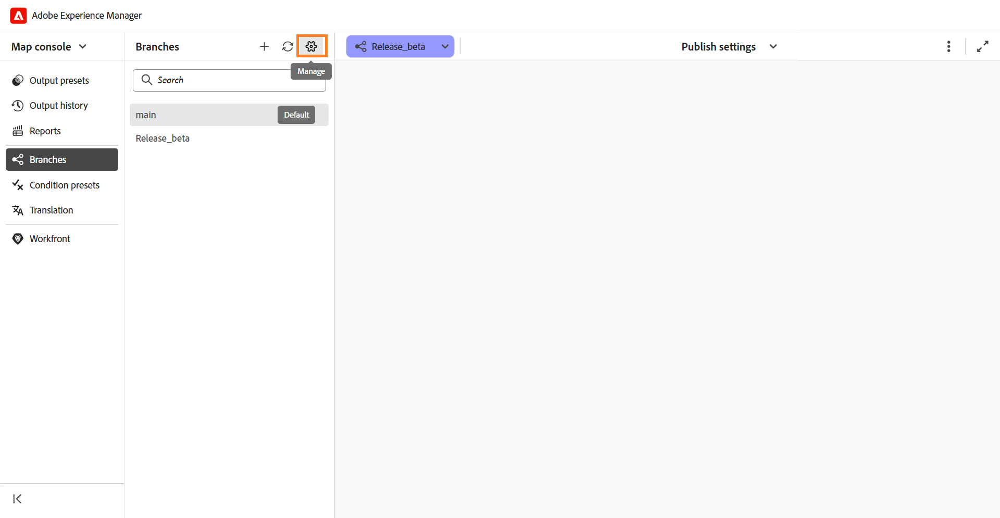

   Viene visualizzata la finestra di dialogo **Gestisci rami**.

   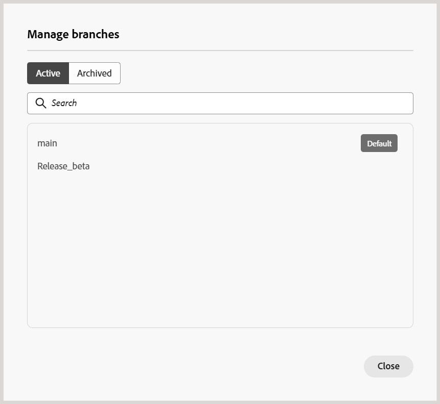

   La finestra di dialogo contiene le seguenti schede:

   - **Attivo:** Elenca tutti i rami attivi della mappa DITA selezionata.
   - **Archiviato:** Elenca tutti i rami archiviati della mappa DITA selezionata.

2. Nella scheda **Active**, passa il cursore del mouse sul ramo da archiviare e seleziona **Archive**.

   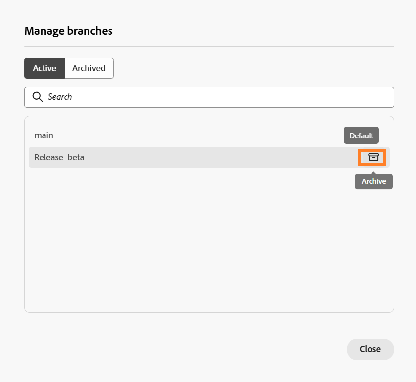

   Il ramo selezionato è stato archiviato e spostato nella scheda **Archiviato**.

### Ripristinare un ramo archiviato

È possibile ripristinare un ramo archiviato di una mappa DITA quando è necessario riprendere a lavorare sul relativo contenuto.

Per ripristinare un ramo archiviato, effettuare le seguenti operazioni:

1. Nel pannello **Rami**, seleziona l&#39;icona **Gestisci**.
2. Nella finestra di dialogo **Gestisci rami**, seleziona la scheda **Archiviato**.
3. Individuare il ramo da ripristinare e selezionare **Ripristina**.

   Il ramo è stato ripristinato e viene visualizzato nella scheda **Attivo**.

