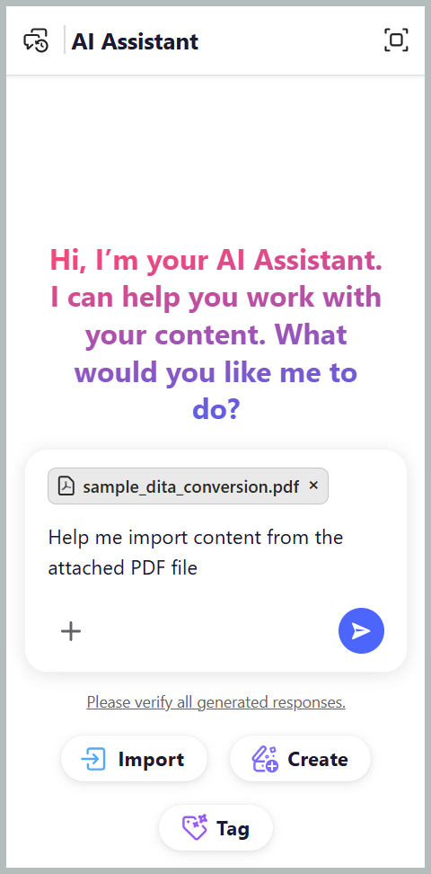
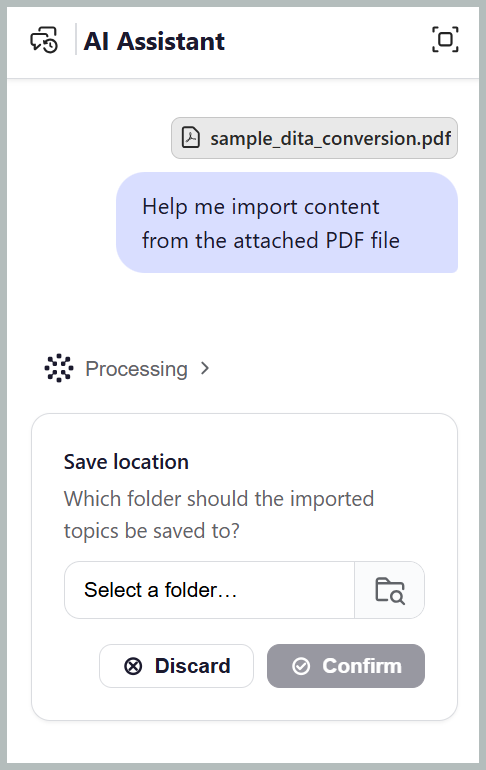
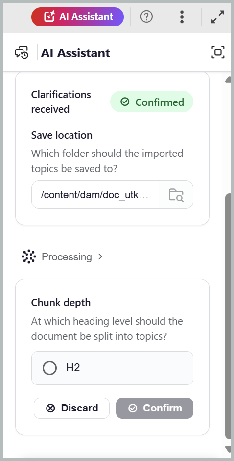
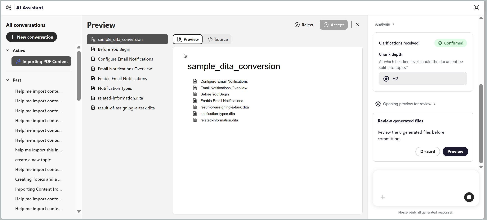
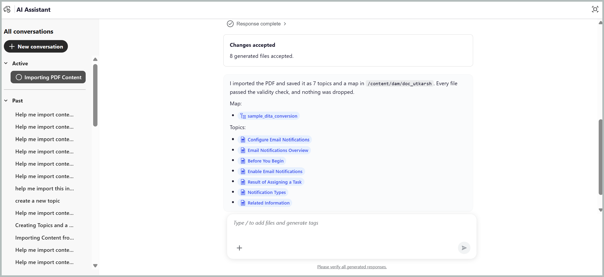
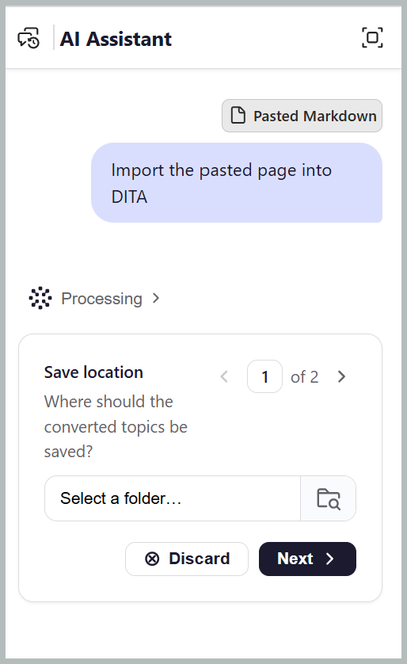

# Importare contenuti con l’Assistente IA

L&#39;abilità **Importa** nella modalità Agentic dell&#39;Assistente di intelligenza artificiale consente di convertire i file PDF, Word o Markdown esistenti in argomenti DITA strutturati, con l&#39;opzione di generare mappe DITA in base all&#39;input dell&#39;utente. Semplifica l’acquisizione dei contenuti da formati non strutturati a formati strutturati in Adobe Experience Manager Guides, riducendo lo sforzo manuale necessario per ricreare, strutturare e organizzare i contenuti.

## Importare un file

È possibile importare file dal dispositivo o dall&#39;archivio dei contenuti, specificare il livello di intestazione che definisce l&#39;inizio di un nuovo argomento e scegliere la cartella di destinazione per il contenuto importato. Per importare un file, effettuare le seguenti operazioni:

1. Accedi a Experience Manager Guides.
1. Nella home page, selezionare **Assistente AI** dalla barra di spostamento. Verificare che l&#39;Assistente di [IA in modalità agente](../install-conf-guide/workspace-settings.md) sia abilitato dall&#39;amministratore.
1. Seleziona **Importa** dal pannello Assistente IA. È inoltre possibile utilizzare altri prompt come *Converti il documento in argomenti DITA* per un file Word o *Converti il markdown in argomenti DITA* per un file Markdown.

   Il prompt iniziale *Guida all&#39;importazione del contenuto dal file PDF allegato* viene visualizzato nella casella del prompt.

1. Allegare il file al prompt utilizzando uno dei metodi seguenti:

   - **Utilizzo del collegamento**: digitare `/` nel campo Prompt, quindi scegliere **Aggiungi riferimento archivio** per scegliere il file dal repository (oppure **Aggiungi file dal dispositivo** per caricare il file dal computer).

   - **Utilizzo dell&#39;icona Allega file o aggiungi contesto (+)**: aggiunge file dal sistema locale per fornire il contenuto da importare.

   - **Trascina e rilascia**: trascina il file che desideri importare dal sistema direttamente nello spazio del prompt.

     

1. Seleziona **Invia**.

   L’Assistente AI analizza il file ed elenca ogni passaggio che completa.

1. Selezionare e confermare la cartella in cui si desidera salvare gli argomenti importati.

   

1. Scegli il livello di intestazione che diventa un argomento. Ad esempio H2 come mostrato nella schermata.

   Rispondere a qualsiasi altra domanda di follow-up che sembri fornire i dettagli necessari per il processo di importazione.

   

1. Seleziona **Conferma**.

   L&#39;Assistente AI avvia la conversione del file. L&#39;abilità di importazione identifica e assegna automaticamente i tipi di argomento DITA appropriati, ad esempio Attività, Risoluzione dei problemi e altro ancora, in base al contenuto importato.

1. Selezionare **Anteprima** per esaminare gli argomenti generati e la mappa.

   Verificare che ogni argomento inizi dall&#39;intestazione prevista e che l&#39;ordine di mappatura corrisponda al file originale. Puoi anche controllare il codice Source dei dati importati utilizzando la scheda Source.

   

1. Selezionare una delle opzioni seguenti:

   - **Accetta** per salvare tutti gli argomenti e la mappa nella cartella confermata.
   - **Rifiuta** per ignorare l&#39;importazione senza salvare nulla. È possibile specificare un motivo per il rifiuto dell&#39;importazione e immettere un prompt specificando le modifiche desiderate. L’Assistente AI utilizza il tuo feedback per rivedere l’importazione.

   Gli argomenti e la mappa sono ora disponibili nel tuo archivio.

   

Al termine della conversione, l’Assistente AI apre un’anteprima degli argomenti e della mappa generati. Puoi passare alla mappa e agli argomenti corrispondenti direttamente dalla finestra di dialogo dell’Assistente AI.

## Importa contenuto incollato come argomenti

Incollando il contenuto da una pagina Web, Word, Google Docs o un wiki è possibile importare senza prima salvare un file. Il contenuto formattato conserva intestazioni, elenchi e tabelle.

Per importare il contenuto incollato:

1. Accedi a Experience Manager Guides.
1. Nella home page, selezionare **Assistente AI** dalla barra di spostamento. Assicurati che l’Assistente AI in modalità Agentic sia abilitato dall’amministratore.
1. Copiare il contenuto dalla pagina Web, da Word, Google Docs o wiki.
1. Incolla il contenuto nella casella del prompt.

   Il contenuto formattato con più di 2.000 caratteri viene allegato come Markdown, in modo che la sua struttura venga mantenuta.

   

1. Immetti un prompt che specifichi il contenuto desiderato.

   Ad esempio, immettere *Importa la pagina incollata in DITA* o *Trasforma il contenuto incollato in argomenti DITA e in una mappa*

1. Seleziona **Invia**.

L&#39;Assistente AI richiede di selezionare il livello di intestazione per suddividere il contenuto in argomenti e specificare la cartella di destinazione. I passaggi rimanenti sono gli stessi dell&#39;importazione di un file allegato, inclusi la revisione e la conferma del flusso di lavoro di importazione per generare argomenti DITA e una mappa.

