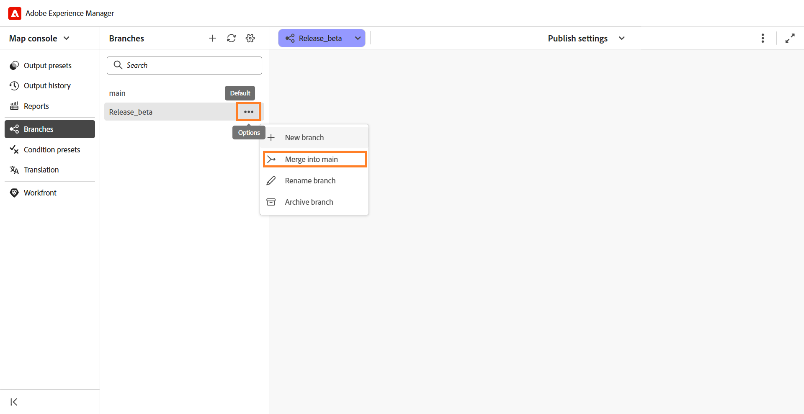
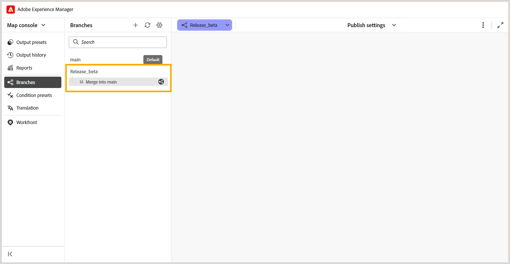
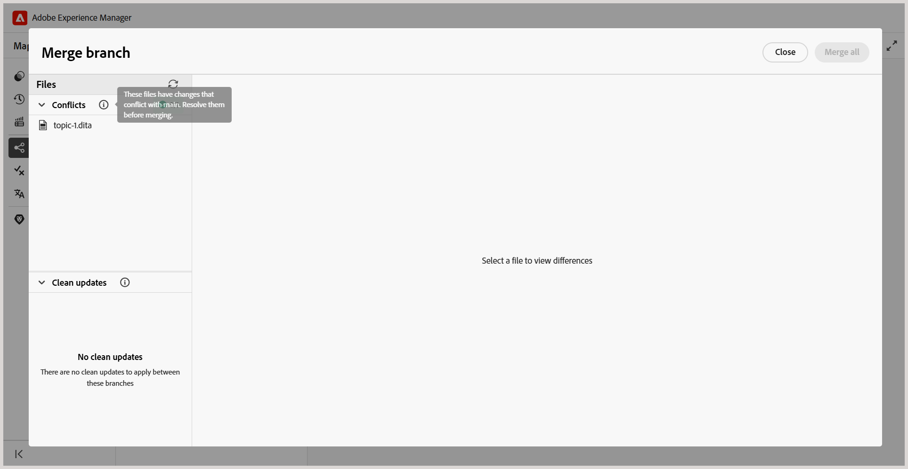
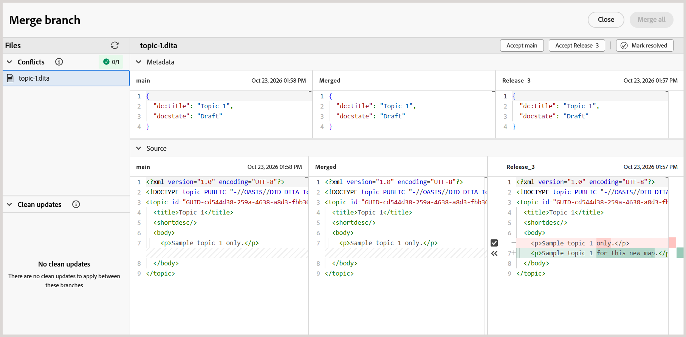
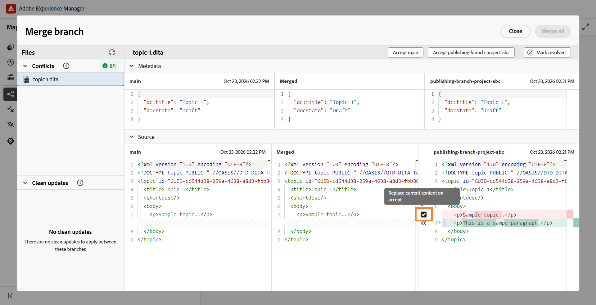
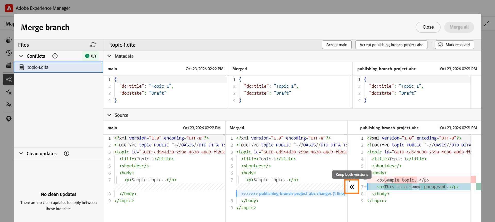

# Unire un ramo in principale

In Experience Manager Guides è possibile unire le modifiche da un ramo di una mappa DITA al ramo `main`. L&#39;unione consente di incorporare gli aggiornamenti della documentazione completati in `main` senza copiare manualmente le modifiche in `main`.

Si consideri ad esempio una mappa DITA denominata `install-the-lift.ditamap` con un ramo denominato `Release 2`. Gli autori possono aggiornare le istruzioni di installazione in questo ramo mentre la documentazione esistente rimane invariata in `main`.

Quando gli aggiornamenti sono pronti, gli autori possono unire le modifiche da `Release 2` a `main`.

## Comprendere l’unione di rami

L&#39;unione porta le modifiche da un ramo selezionato di una mappa DITA nel ramo `main`.

- **Ramo Source:** Il ramo contenente le modifiche che si desidera unire.
- **Ramo di destinazione:** Il ramo predefinito (`main`) in cui vengono unite le modifiche.

Se la stessa parte di un argomento/mappa è stata modificata in entrambi i rami, possono verificarsi conflitti di unione che richiedono una risoluzione.

## Unire un ramo

È possibile unire le modifiche da un ramo selezionato di una mappa DITA in `main`.

Per unire un ramo, effettuate le seguenti operazioni:

1. Apri la mappa DITA richiesta nella console Mappa.
2. Passa alla scheda **Rami**.
3. Individuare il ramo contenente le modifiche da unire.
4. Apri il menu **Opzioni** del ramo e seleziona **Unisci in principale**.

   

   Viene creata una richiesta di unione per il ramo selezionato. Consente di rivedere le modifiche e risolvere eventuali conflitti prima di unirli in `main`.

   

5. Seleziona la richiesta di unione.

   La richiesta di unione si apre nella visualizzazione **Unisci ramo**. Rivedi le modifiche e risolvi eventuali conflitti, se necessario.
6. Completate l&#39;unione.

   Rivedi le modifiche e risolvi eventuali conflitti, se necessario. Per ulteriori informazioni, visualizzare [Risolvi conflitti di unione](#resolve-merge-conflicts).

   Una volta risolti tutti i conflitti, selezionare **Unisci tutti** per unire le modifiche in `main`.

   Le modifiche vengono unite al ramo `main`.

## Risolvi conflitti di unione

Un conflitto di unione si verifica quando lo stesso contenuto è stato modificato sia in `main` che nel ramo unito. È necessario risolvere tutti i conflitti prima di unire le modifiche in `main`.

Quando si apre una richiesta di unione, nella visualizzazione **Unisci ramo** vengono visualizzate le sezioni seguenti:

- **Conflitti:** elenca i file che richiedono la risoluzione dei conflitti.
- **Aggiornamenti puliti:** elenca i file che possono essere uniti senza risolvere i conflitti.

Per i file con conflitti, viene visualizzata una visualizzazione **Unisci ramo**.

La visualizzazione **Unisci ramo** contiene i riquadri seguenti:

- **Riquadro sinistro (principale):** Visualizza il contenuto del ramo predefinito (`main`).
- **Riquadro centrale (unito):** Visualizza il contenuto unito, in cui è possibile accettare le modifiche da un ramo o modificare direttamente il contenuto.
- **Riquadro destro (ramo selezionato):** Visualizza il contenuto del ramo da unire in `main`.

Le differenze sono evidenziate nei riquadri sinistro e destro in base al contenuto nel riquadro **Unito**:

- **Rosso (-):** indica il contenuto presente nel riquadro **Unito** che è diverso dal contenuto nel riquadro destro o sinistro corrispondente.
- **Verde (+):** indica il contenuto presente nel riquadro sinistro o destro non incluso nel riquadro **Unito**.

Inizialmente, il riquadro **Unito** contiene lo stesso contenuto di `main`, pertanto le differenze sono evidenziate nel riquadro di destra. Dopo aver accettato le modifiche dal ramo selezionato, nel riquadro di sinistra vengono visualizzate le differenze rispetto al riquadro **Unito** aggiornato.

Per risolvere i conflitti di unione, effettuare le seguenti operazioni:

1. Nella sezione **Conflitti** selezionare il file contenente i conflitti.

   >[!NOTE]
   >
   > I file elencati in **Aggiornamenti puliti** contengono modifiche apportate solo nel ramo selezionato e non richiedono pertanto la risoluzione dei conflitti.

2. Esaminare le differenze evidenziate nella visualizzazione **Unisci ramo** e risolvere i conflitti utilizzando i controlli di unione.

   La casella di controllo accanto a un conflitto nel riquadro di destra determina il modo in cui il contenuto del ramo selezionato viene aggiunto al riquadro **Unito**:

   - **Selezionato (impostazione predefinita):** sostituisce il contenuto corrispondente nel riquadro **Unito** con il contenuto del ramo selezionato.
   - **Cancellato:** aggiunge il contenuto del ramo selezionato insieme al contenuto esistente nel riquadro **Unito** senza sostituirlo.

   Puoi risolvere i conflitti utilizzando le seguenti opzioni:

   - Se si desidera utilizzare le modifiche del ramo selezionato, mantenere selezionata la casella di controllo relativa al conflitto, quindi selezionare il controllo freccia rivolta a sinistra corrispondente (`<<<`). Il contenuto del ramo selezionato sostituisce il contenuto in conflitto nel riquadro **Unito**.

     

   - Se si desidera mantenere il contenuto di entrambi i rami, deselezionare la casella di controllo relativa al conflitto, quindi selezionare il controllo freccia rivolta a sinistra (`<<<`). In questo modo il contenuto del ramo selezionato verrà aggiunto al riquadro **Unito** senza sostituire il contenuto già presente in tale riquadro.

     

   - Se sono state accettate le modifiche dal ramo selezionato e si desidera ripristinare il contenuto corrispondente da `main`, selezionare il controllo freccia rivolta a destra (`>>>`) nel riquadro sinistro. Sostituisce il contenuto selezionato nel riquadro **Unito** con la versione di `main`.

   >[!TIP]
   >
   > Passa il puntatore del mouse su un controllo freccia per vedere come l&#39;accettazione della modifica selezionata influirà sul riquadro **Unito**.

3. Dopo aver esaminato il contenuto unito, puoi anche utilizzare una delle seguenti opzioni per accettare l’intero contenuto da uno dei rami:

   - **Accetta principale:** sostituisce il contenuto del riquadro **Unito** per il file selezionato con la versione di `main`.
   - **Accetta [nome ramo]:** Sostituisce il contenuto del riquadro **Unito** per il file selezionato con la versione del ramo selezionato.

   >[!NOTE]
   >
   > Se si seleziona una delle due opzioni, l&#39;intero contenuto del **riquadro unito** per il file selezionato verrà sostituito, incluse eventuali modifiche apportate manualmente durante la risoluzione dei conflitti.

   In alternativa, è possibile rivedere o modificare il contenuto direttamente nel riquadro **Unito** e selezionare **Contrassegna come risolto** per mantenere il contenuto unito.

4. Rivedi il contenuto finale nel riquadro **Unito** e seleziona **Contrassegna come risolto** per contrassegnare il file come risolto.

5. Ripeti i passaggi per tutti i file elencati in **Conflitti**.

   Una volta risolti tutti i conflitti, diventa disponibile l&#39;opzione **Unisci tutti**.

6. Selezionare **Unisci tutti** per unire i file risolti e gli aggiornamenti puliti in `main`.

   >[!NOTE]
   > 
   > L&#39;opzione **Unisci tutti** rimane disabilitata fino alla risoluzione di tutti i conflitti.

   Le modifiche risolte vengono unite in `main`. Impossibile annullare un&#39;unione completata. Tuttavia, puoi creare una nuova richiesta di unione per unire le modifiche successive in main.

## Gestire una richiesta di unione

Puoi gestire le richieste di unione esistenti utilizzando il menu di scelta rapida.

Per gestire una richiesta di unione, apri il relativo menu di scelta rapida e seleziona una delle opzioni seguenti:

- **Anteprima:** mostra le modifiche nella richiesta di unione senza unirle.
- **Visualizza registro:** Visualizza il registro associato alla richiesta di unione.
- **Elimina:** Elimina la richiesta di unione. Il ramo e le relative modifiche non vengono influenzati.
- **Visualizza report:** Visualizza il report di unione dopo l&#39;unione del branch in `main`.