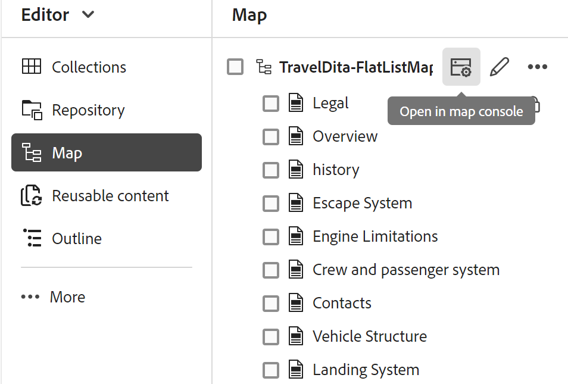

# Apri file nella console Mappa

Per aprire un file mappa DITA nella console Mappa, effettuare le seguenti operazioni:

1. Apri **Map console** dalla home page.

   {width="800"}

2. Poiché non è selezionato alcun file di mappa, viene richiesto di selezionare un file di mappa per utilizzare le funzioni di gestione e pubblicazione delle mappe.

   

3. Scegliere **Seleziona mappa** e selezionare un percorso in cui si trova il file di mappa DITA.

   Il file mappa si apre nella console Mappa. Per impostazione predefinita, la scheda **Predefiniti di output** è selezionata.

   {width="800"}

   >[!NOTE]
   >
   >  La mappa aperta nella console Mappa viene sincronizzata con la vista Mappa disponibile nell’editor.

## Aprire i file di mapping dall&#39;editor

Puoi anche aprire un file di mappa esistente nella console Mappa dall’editor.

1. Passare al file di mapping DITA e selezionarlo nella vista Archivio.

   Il file mappa si apre nella vista Mappa.

2. Seleziona l&#39;icona **Apri nella console delle mappe**.

   Il file mappa si apre nella console Mappa.

   
