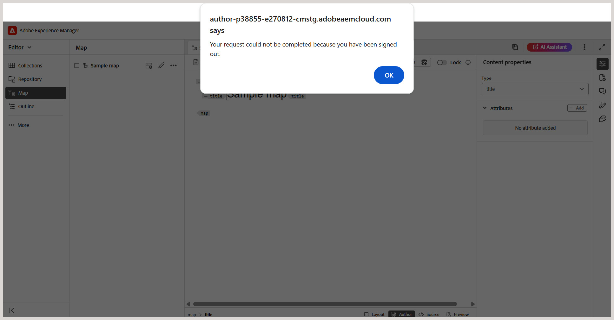

# Perché Experience Manager Guides mi disconnette dopo un determinato periodo di tempo?

Experience Manager Guides termina una sessione utente dopo un determinato periodo di inattività (timeout di inattività). Questa funzionalità di disconnessione automatica è configurata in Adobe Experience Manager. Alla scadenza della sessione, viene visualizzato un avviso popup per informare l’utente della sessione scaduta. Questo avviso impedisce all’utente di apportare ulteriori modifiche al contenuto.

**Come funziona il timeout della sessione?**

Experience Manager Guides invia una richiesta in background `token.json` ogni 30 secondi per convalidare la sessione. Se la sessione è ancora attiva, viene restituito un token valido. Se la sessione è scaduta per inattività, viene restituito un token vuoto e la sessione viene considerata inattiva.

**Cosa succede alla scadenza della sessione?**

Quando viene rilevata una sessione inattiva:

- Viene visualizzato un avviso popup per segnalare che l&#39;utente è stato disconnesso.

  

- L&#39;avviso disattiva tutte le interazioni con l&#39;applicazione.

- Selezionando **OK** si aggiorna il browser e si viene reindirizzati alla pagina di accesso.
- Dopo aver effettuato l’accesso, vieni reindirizzato all’ultima pagina aperta di Experience Manager Guides.

**Passaggi successivi**

L’avviso di scadenza della sessione aiuta a prevenire la perdita di dati limitando l’opportunità di apportare modifiche all’applicazione durante una sessione inattiva. Per evitare la perdita accidentale di contenuto, si consiglia di salvare il lavoro regolarmente nell’editor, in particolare prima di uscire dal sistema per un periodo prolungato.
