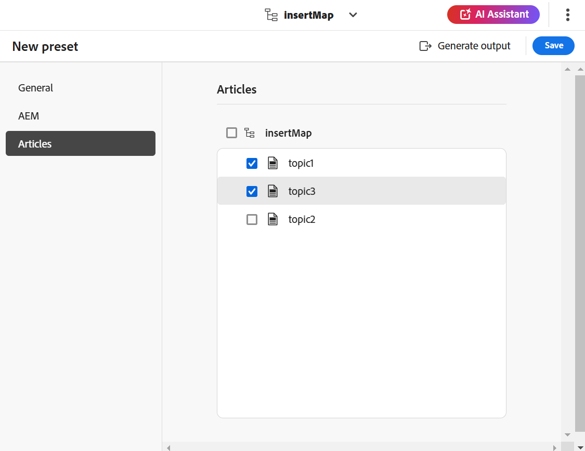
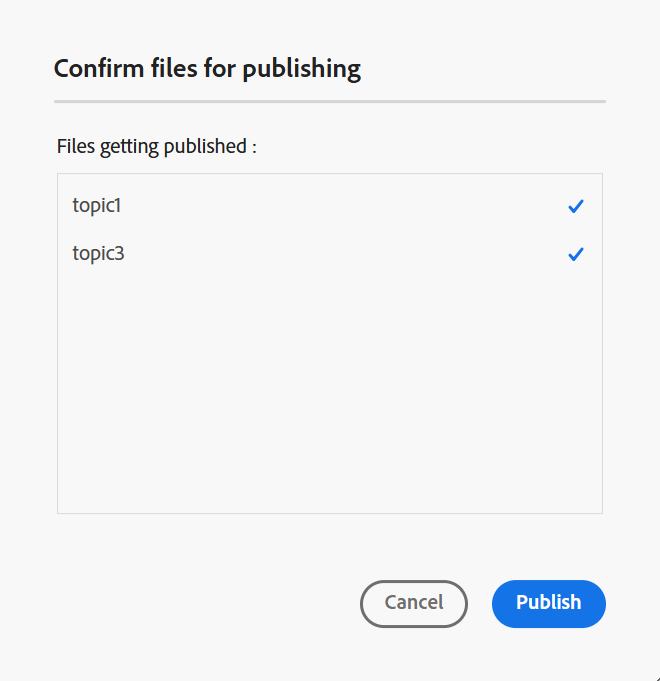
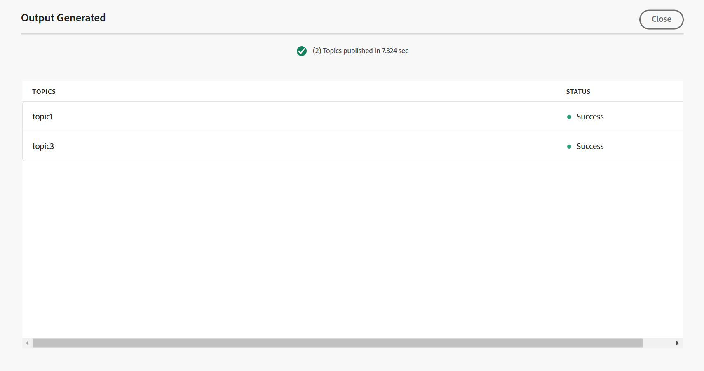
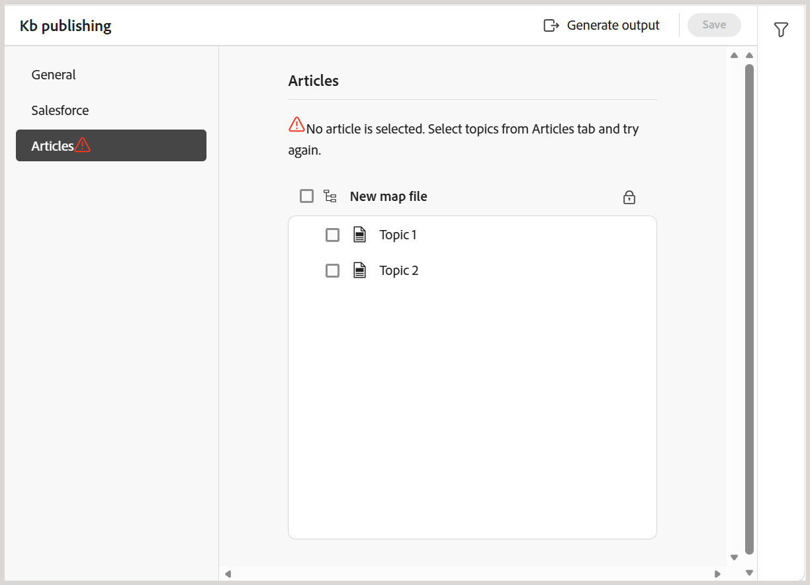
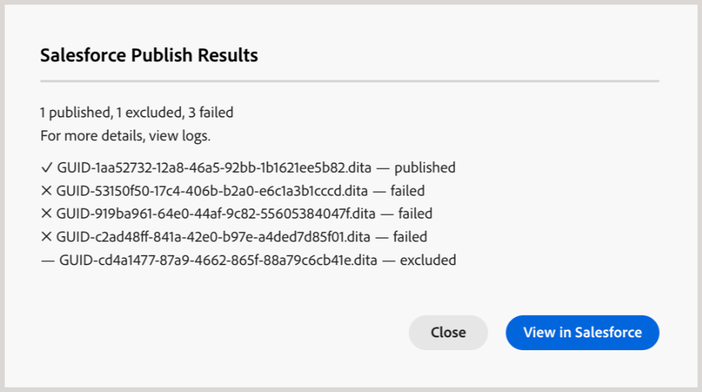
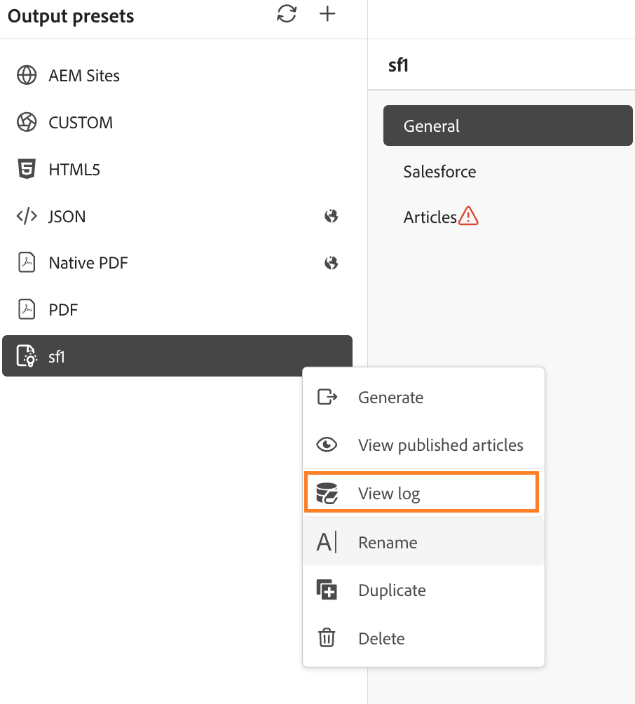
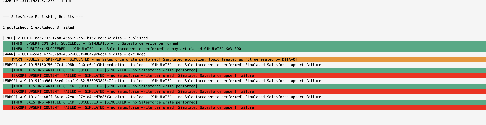
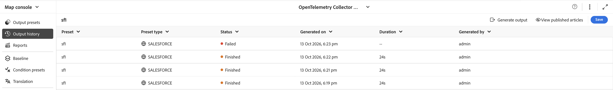

# Genera output Knowledge Base {#id218CL05J0M1}

Adobe Experience Manager Guides viene fornito con una funzione di pubblicazione basata su articoli che consente agli utenti di pubblicare uno o più articoli della Knowledge Base simultaneamente.

Questo motore viene fornito anche con un modello di contenuto OOTB, basato sui componenti core di Adobe Experience Manager, che consente agli utenti di creare un archivio dei contenuti tecnici basato sulle conoscenze. Questo modello può essere personalizzato in base alle esigenze dei clienti.Questo motore consente agli utenti di creare la mappa DITA in modo additivo e pubblicare argomenti quando e come sono pronti.

Se il contenuto è stato aggiornato solo per alcuni argomenti della mappa DITA, non è sempre necessario pubblicare l&#39;intera mappa. Puoi selezionare e pubblicare solo gli argomenti aggiornati.

Per la pubblicazione basata su articoli, è necessario creare il predefinito di output per la mappa DITA della Knowledge Base. La mappa deve includere gli argomenti che desideri pubblicare. Puoi anche applicare le condizioni e specificare i dettagli di AEM Sites per il predefinito di output. Quindi, puoi generare l&#39;output utilizzando la funzionalità **Genera output**.

Per generare un output basato su articoli, effettua le seguenti operazioni:

1. [Creare il predefinito della Knowledge Base](./generate-output-knowledge-base.md) per l&#39;output basato su articoli.
1. Passa alla scheda **Articoli** e seleziona gli argomenti per i quali desideri generare l&#39;output.

   

   >[!NOTE]
   >
   > Quando si pubblica in Salesforce, accanto alla scheda **Articoli** viene visualizzata un&#39;icona di avviso se non è selezionato alcun argomento da pubblicare. L&#39;icona di avviso scompare quando si selezionano uno o più argomenti.
1. Seleziona **Genera output** nella parte superiore per generare l&#39;output.
1. Nel prompt **Conferma file per la pubblicazione**, selezionare i file da pubblicare e confermare selezionando **Pubblica**.

   

   Viene visualizzato lo stato del processo di generazione dell&#39;output. Nella colonna **Argomenti** sono elencati gli argomenti per i quali viene generato l&#39;output mentre nella colonna **Stato** è visualizzato lo stato di pubblicazione di ciascun argomento.

   

   Per visualizzare l&#39;output, chiudere la finestra di dialogo **Output generato** e selezionare **Visualizza output** nella pagina predefinita.

   >[!NOTE]
   >
   > È inoltre possibile rinominare, duplicare o eliminare un predefinito di output esistente dal menu Opzioni.

## Pubblicazione avanzata di Salesforce tramite elaborazione back-end

A partire dalla versione 2026.11.0 di Experience Manager Guides as Cloud Service, è disponibile un’esperienza di pubblicazione su Salesforce migliorata. Utilizza l’elaborazione back-end per supportare processi di pubblicazione più ampi, migliorare la sicurezza e risolvere i problemi con il processo di pubblicazione esistente.

>[!NOTE]
>
> L’esperienza di pubblicazione avanzata di Salesforce è disabilitata per impostazione predefinita. Per abilitarlo, contatta il team Customer Success di Adobe.

Quando pubblichi articoli in Salesforce utilizzando l’esperienza avanzata, sono disponibili le seguenti funzionalità aggiuntive:

- **Avviso per argomenti non selezionati**: nella scheda **Articoli** del predefinito di output della Knowledge Base di Salesforce viene visualizzato un indicatore di avviso quando non è selezionato alcun argomento da pubblicare. L&#39;avviso scompare quando si selezionano uno o più argomenti.

  
- **Stato pubblicazione a livello di articolo**: dopo la generazione dell&#39;output, lo stato di pubblicazione di ciascun articolo, ad esempio Completato o Non riuscito, insieme al relativo argomento o nome di file viene visualizzato nella finestra di dialogo **Risultati pubblicazione Saleforce**.

  

- **Registri di pubblicazione**: utilizzare l&#39;opzione **Visualizza registro** nel predefinito di output della Knowledge Base di Salesforce per esaminare i registri di pubblicazione e risolvere eventuali errori o avvisi.

  

  I registri forniscono anche un riepilogo dei risultati di pubblicazione.

  
- **Cronologia output**: visualizza la cronologia di output delle attività di pubblicazione dalla **console mappa** o dalla **interfaccia utente di Assets**.

  Per ulteriori informazioni sulla gestione delle attività di pubblicazione, visualizzare [Gestisci processo di generazione output](./generate-output-manage-process.md).

  
- **Pubblicazione ottimizzata delle risorse:** Quando si pubblicano argomenti in Salesforce, Experience Manager Guides controlla se le risorse a cui si fa riferimento, ad esempio file multimediali e altri file non DITA, sono state modificate dopo l&#39;ultima pubblicazione. Solo le risorse modificate vengono pubblicate nuovamente, mentre le risorse non modificate vengono ignorate. Questo riduce gli aggiornamenti ridondanti delle risorse e migliora l’efficienza di pubblicazione.

### PKCE e aggiornamento dell’autenticazione basata su token

L’esperienza di pubblicazione avanzata di Salesforce supporta anche l’autenticazione basata su token di aggiornamento, riducendo la necessità di accedere ripetutamente a Salesforce da Experience Manager Guides alla scadenza dei token di accesso.

>[!NOTE]
>
> Il supporto per i token di aggiornamento è disabilitato per impostazione predefinita. Per abilitarlo, contatta il team Customer Success di Adobe.

Per utilizzare questa funzionalità, accertati che **Esegui richieste in qualsiasi momento (refresh_token, offline_access)** sia incluso negli ambiti OAuth selezionati e che **L&#39;estensione Require Proof Key for Code Exchange (PKCE) for Supported Authorization Flows** sia abilitata nell&#39;app connessa a Salesforce.

L’abilitazione del supporto dei token di aggiornamento in Experience Manager Guides abilita automaticamente il supporto PKCE. Tuttavia, per il corretto funzionamento dell’autenticazione è necessario abilitare anche l’impostazione corrispondente in Salesforce.

**Argomento padre:**&#x200B;[&#x200B; Utilizzare l&#39;editor](web-editor.md)
