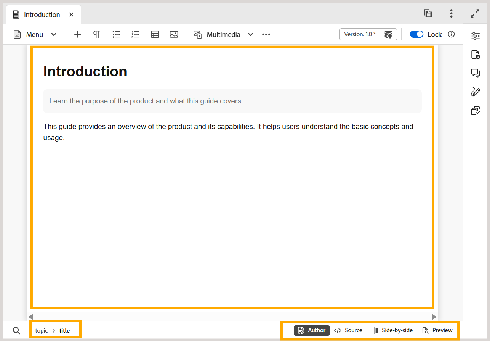

# Area di modifica dei contenuti nell’editor

>[!INFO]
>
> Questo argomento si applica sia al nuovo editor che al vecchio editor. Anche se le funzionalità di base rimangono coerenti, le differenze nell’interfaccia utente, nella terminologia e nelle interazioni sono indicate all’interno del contenuto utilizzando schede e callout, se applicabile.

Nell&#39;area di modifica del contenuto viene visualizzato il contenuto dell&#39;argomento o della mappa. In quest’area vengono apportate tutte le modifiche al contenuto. Offre una visualizzazione WYSIWYG del contenuto che si sta modificando.

Nella parte inferiore sinistra dell’area di modifica dei contenuti è presente la breadcrumb dell’elemento nella posizione corrente del cursore. Nell’angolo in basso a destra vengono visualizzate le viste dell’Editor disponibili.

>[!BEGINTABS]

>[!TAB Nuovo editor]

>[!TAB Editor precedente]

>[!ENDTABS]

Per ulteriori informazioni sulle visualizzazioni dell&#39;editor disponibili per un file di argomento nell&#39;area di modifica del contenuto, visualizzare [Visualizzazioni dell&#39;editor](./web-editor-views.md).

>[!NOTE]
>
> Se si sta lavorando su un file mappa, nell&#39;area di modifica del contenuto vengono visualizzate opzioni o viste diverse. Per ulteriori dettagli, visualizzare [le funzionalità dell&#39;editor di mappe](./map-editor-advanced-map-editor.md).

**Argomento padre:**[ Introduzione all&#39;editor](web-editor.md)
