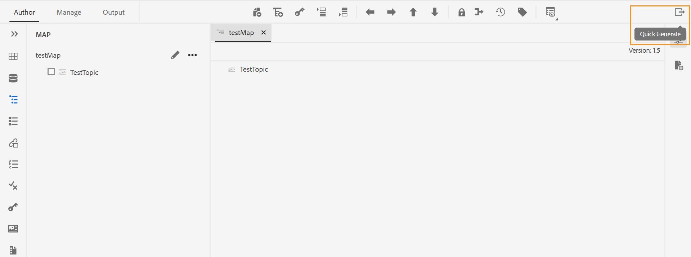

# Utilizza il pannello Generazione rapida per generare e visualizzare l’output {#id22AKE050F5L}

>[!NOTE]
>
> Il pannello Generazione rapida, precedentemente disponibile in Adobe Experience Manager Guides, è diventato obsoleto a partire dalle versioni 4.0 e 2502. Impossibile accedere al pannello Generazione rapida per generare e visualizzare l’output

AEM Guides fornisce un pannello **Generazione rapida** integrato nell&#39;editor Web. Questo pannello consente di generare simultaneamente l&#39;output per i predefiniti di output creati per una mappa DITA. È possibile generare l&#39;output per uno o più predefiniti o per tutti i predefiniti creati per una mappa DITA. È inoltre possibile utilizzare il pannello **Generazione rapida** per visualizzare successivamente l&#39;output generato per i predefiniti.

>[!NOTE]
>
> Viene visualizzato il pannello **Generazione rapida** per la mappa DITA aperta nel pannello Visualizzazione mappa.

Per generare l&#39;output dal pannello **Generazione rapida**, effettua le seguenti operazioni:

1. Apri la mappa DITA in Vista mappa. Viene visualizzata l’icona Generazione rapida. Viene visualizzato nelle schede **Autore** e **Gestione**.
1. Fai clic sull&#39;icona **Generazione rapida** \( \) per aprire il pannello **Generazione rapida**. Nel pannello **Generazione rapida** è possibile visualizzare l&#39;elenco di tutti i predefiniti di output creati per la mappa DITA.
1. Selezionate uno o più predefiniti per i quali desiderate generare l&#39;output.
1. Fai clic su **Genera** per generare l&#39;output per i predefiniti selezionati. Alla generazione dell’output viene visualizzato un messaggio di successo. Se la generazione non riesce, viene visualizzato un messaggio di errore. Puoi anche visualizzare il registro degli errori per visualizzare i dettagli dell’errore che si è verificato nel processo di generazione.
1. Fare clic sull&#39;icona **Visualizza output** \( \) di un predefinito specifico per visualizzare l&#39;output generato per il predefinito.

**Argomento padre:**[ Utilizzare l&#39;editor Web](web-editor.md)
